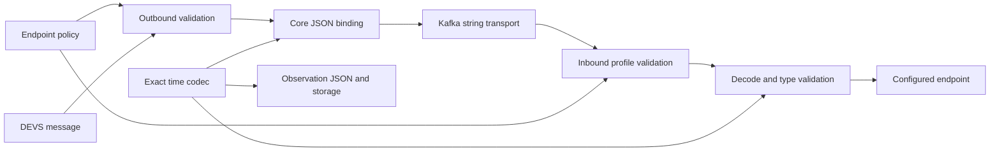

# Current State

### Scope and investigation
Planning only: no source files or schemas have been modified, and no builds or tests have been run. Inspected source, existing tests, both requested schemas, Maven dependencies, and time/Kafka documentation.

The Java 21 Maven reactor contains `devs-streaming-core`, `devs-streaming-kafka`, and MongoDB/PostgreSQL observation modules. Jackson is `2.17.3`; message/time value classes are often generated by Immutables from checked-in `Abstract*` sources. Implementation must change those sources, not generated files.

### Confirmed findings
| Path/component | Current behavior and consequence |
|---|---|
| `core: devs/iso/time/SimTime.java` | Standalone polymorphism uses `Id.CLASS` in `timeType`; listed subtypes are long/double. This is a different representation from message timestamp fields. |
| `DecimalSimTime.java` | Immutable `BigDecimal`, normalized with `stripTrailingZeros()`. Distinguished infinity has a null internal value; `getT()` throws for infinity. No exact Jackson construction/binding is provided. Lexical/scale preservation is already impossible after construction. |
| `QuantizedSimTime.java`, `devs/time/Rational.java` | Canonical rational seconds with distinguished infinity. Rational components are `BigInteger`; construction reduces fractions, makes denominators positive, and normalizes zero to `0/1`. No explicit exact JSON binding exists. |
| `devs/utils/DevsObjectMapper.java` | Registers JDK8, Guava, and Java-time modules; ignores unknown properties globally. No time module or profile configuration. |
| `FlexibleNumberSerializer.java` | Writes long/double JSON numbers; rejects other `SimTime` types. |
| `FlexibleNumberDeserializer.java` | Parses token text as long, then falls back to double. Thus text such as `1`, `1.0`, `1e0`, numeric strings, and out-of-long-range integers can have distinct legacy results. Preserve that behavior rather than replacing it with token-based inference. |
| `TimedMessage.java` | `eventTime` overrides standalone polymorphism with flexible-number binding and `Id.NONE`. |
| `AbstractNextInternalTimeReport.java`, `AbstractOutputReport.java`, `AbstractTransitionComplete.java` | Apply the same binding to `nextInternalTime`. |
| `AbstractSimulationInit`, `AbstractSimulationTerminate`, `AbstractRequestOutput`, `AbstractExecuteTransition` | Inherit `eventTime` binding. `AbstractModelTerminated` has no timestamp despite its generic type. |
| `SimulationInitMessage.java` | Local wrapper contains a parent actor reference and optional `EnhancedClockContext`. Neither is a portable timestamp representation. |
| `AbstractDevsStreamProxy.java` | Validates event/next times as long/double, rejects any enhanced context, unwraps initialization, then serializes and publishes with sequence numbers. |
| `AbstractDevsStreamReceiver.java` | Reads `DevsSimMessage`, filters receiver ID, reconstructs an initialization wrapper with a local sender, dispatches. No explicit endpoint time/profile validation. |
| `AbstractLocalProxy.java` | Separate inbound decode path; forwards replies to its learned parent. Outbound parent capture/shutdown currently precede superclass validation. Both paths must participate in validation. |
| Kafka adapters | Thin subclasses of core proxies/receivers. `KafkaMessagePublisher` keys records by run ID and writes `X-Run-Id`, `X-Receiver-Id`, `X-Sequence`. `KafkaMessageReceiver` filters run headers before JSON decoding and uses `runId:receiverId` groups. No timestamp-driven key or partition change is necessary. |
| `KafkaSimTimeKey.java` | Public compatibility class, but repository references show no active producer usage. Do not restore time-based Kafka keys. |
| `SimTimeKeySerializer/Deserializer.java`, `Schedule.java`, `ImmutableSchedule.java` | Still-active JSON map-key path; numeric keys only, with legacy prefixed-key decoding. Separate from Kafka record keys. |
| `AbstractObservation.java` | `time` uses standalone `SimTime` polymorphism, not flexible-number binding. `ObservationSerializationTest` currently checks long observations only. |
| `DevsObservationActor.java`, `FileObservationActor.java` | Emit JSON/JSONL through `DevsObjectMapper`. |
| `MongoObservationActor.java` | Serializes to JSON then `Document.parse`; indexes `(runId, branchId, time)`. Exact strings remain strings, but sorting objects/text is not exact chronological sorting. |
| `PostgresObservationActor.java` | Stores separate `time`, payload, and whole observation as JSONB. New tagged string components require no SQL column migration. No timestamp-sort index currently exists. |
| `TimeState`, `ImmutableTimeState`, `ScheduleState` | Additional nested time/state and schedule serialization consumers; require regression coverage. |
| `AbstractBranch.java` | `forkTime` is a separate `Double`, not a `SimTime`. Changing that API is outside this proposal; do not claim all branch metadata becomes exact. |

### Execution boundaries
`ChildBinding`, `TimeMapping`, native codecs, and `DeliveryRule` enforce concrete native types, exact codec round-trips, timestamp lattices, alignment, and developer-selected adaptation. `DecimalTimeCodec.encode()` cannot represent `1/3` as a finite decimal. Wire decoding must never bypass these rules.

`PDevsCoordinator.initializeEnhanced()` requires a matching clock context and finite canonical initialization. `ChildBinding.validateClock()` compares clock identity and composition origin. Current inbound receivers reconstruct wrappers without that context. Rational serialization alone cannot enable a distributed enhanced hierarchy.

### Confirmed versus potential external dependencies
- **Confirmed:** `devs-streaming-kafka/pom.xml` depends on `cloud.simlytics:model-library-server-java:1.0.0-SNAPSHOT`; `RemoteModelStarter` builds that library's start-run/context DTOs. The inspected start path has no explicit exact-profile agreement.
- **Confirmed:** repository Kafka documentation describes non-Java clients; these clients must agree to the new profile before use.
- **Potential, not inspected:** deployed server implementations, generated OpenAPI clients, downstream observation readers, schema registries, replay tools, and database queries assuming numeric timestamps or Java-qualified `timeType` values.
- Existing standalone and message tests sometimes print results or use Java `assert`. New acceptance checks will use JUnit assertions, including value and concrete class.

# Wire Contract

### Recommended exact-v1 timestamp representation
Use tagged objects for **only the new time types**. `timeType` is a closed language-neutral vocabulary: `decimal` or `rational`. Long/double message fields retain existing numeric encoding and decoding. `rational` maps to `QuantizedSimTime`, not a new native supplier encoding.

| Value | Exact JSON |
|---|---|
| Decimal `0.1` | `{"timeType":"decimal","value":"0.1"}` |
| Decimal zero | `{"timeType":"decimal","value":"0"}` |
| Integer-valued decimal | `{"timeType":"decimal","value":"1"}` |
| Negative decimal | `{"timeType":"decimal","value":"-12.5"}` |
| High precision | `{"timeType":"decimal","value":"0.12345678901234567890123456789"}` |
| Large exponent | `{"timeType":"decimal","value":"1E+1000"}` |
| Small exponent | `{"timeType":"decimal","value":"1E-1000"}` |
| Decimal infinity | `{"timeType":"decimal","infinity":"positive"}` |
| Rational `1/3` | `{"timeType":"rational","numerator":"1","denominator":"3"}` |
| Rational `1/60` | `{"timeType":"rational","numerator":"1","denominator":"60"}` |
| Rational zero | `{"timeType":"rational","numerator":"0","denominator":"1"}` |
| Negative rational | `{"timeType":"rational","numerator":"-2","denominator":"3"}` |
| Large rational | `{"timeType":"rational","numerator":"123456789012345678901234567890","denominator":"7"}` |
| Rational infinity | `{"timeType":"rational","infinity":"positive"}` |

Finite and infinity branches are mutually exclusive, with no additional timestamp-object properties. Denominator zero is never infinity. No `null`, negative infinity, NaN, Java class name, actor reference, or legacy sentinel is introduced into these objects.

Complete-message example:
```json
{
  "wireProfile": "devs-exact-time-v1",
  "messageType": "NextInternalTimeReport",
  "simulationRunId": "run-1",
  "messageId": "report-1",
  "senderId": "decimal-model",
  "receiverId": "coordinator",
  "eventTime": {"timeType": "decimal", "value": "0.1"},
  "nextInternalTime": {"timeType": "decimal", "infinity": "positive"}
}
```

### Type distinction and legacy coexistence
- Bare message timestamp numbers continue through the **unchanged long-first/double-fallback parser**. A decimal-looking number still means double, not `DecimalSimTime`.
- Tagged decimal always decodes as `DecimalSimTime`, including `"1"`. Tagged rational always decodes as `QuantizedSimTime`, including `1/1`.
- Preserve existing accepted legacy scalar strings and overflow fallback; do not retrofit strict exact rules onto those scalar inputs.
- Typed decode requests must reject a mismatched tagged type instead of coercing it. Endpoint policy can be stricter than the JSON codec.
- Default `DevsObjectMapper.buildObjectMapper()` gains new **standalone/observation** time support, while its DEVS timestamp-field binding remains legacy unless explicitly configured for exact-v1.
- Preserve long/double standalone objects, including their existing Java-qualified `timeType` and `t` field. A mapper-local hybrid type binding recognizes the new short tags and delegates the established long/double object path. Do not globally change `SimTime` to `Id.NAME` or enable default typing.
- New standalone values use the same tagged objects above. A new mapper reads historical long/double observations; an old mapper is not expected to understand newly introduced types. No rewrite of historical archives.
- Custom exact serializers must handle polymorphic `serializeWithType` correctly: exactly one discriminator and no getter access for infinity. Test both concrete-root and `SimTime`-root readers/writers.
- Existing payload class metadata and observation envelope class metadata are not redesigned. The new **timestamp contract** is language-neutral; this proposal does not claim every existing arbitrary payload is language-neutral.

### Decimal lexical rules
Accept this ASCII grammar, without whitespace inside the string:
```text
-?(0|[1-9][0-9]*)(\.[0-9]+)?([eE][+-]?[0-9]+)?
```
Reject leading `+`, leading integer zeros, `.1`, `1.`, commas, hex, whitespace, NaN, and infinity spelled as a finite value.

Parse directly using `BigDecimal`, with no floating-point intermediate or rounding context. Accept exponent forms and trailing zeros; serialize the normalized value with `stripTrailingZeros().toString()` (Java's documented compact decimal/scientific rendering), with zero emitted as `"0"`. For example, `"1.2300"` becomes `"1.23"`, `"1000.00"` becomes `"1E+3"`, and `"-0.00"` becomes `"0"`. Promise **numerical value and concrete type**, not original spelling, scale, exponent spelling, or signed zero.

### Rational lexical rules
- Numerator: `-?(0|[1-9][0-9]*)`; denominator: `[1-9][0-9]*`.
- No numeric JSON components, leading `+`, leading zeros, whitespace, or signed/zero denominator.
- Accept bounded noncanonical fractions such as `2/6`; normalize with `Rational.of(BigInteger, BigInteger)` and emit `1/3`.
- Emit reduced fractions with positive denominator; emit all zeros as `0/1`. Normalize numerator `-0` to zero.
- Wire rejection of negative denominators is deliberate even though the local `Rational` constructor normalizes them.

### Fixed resource limits selected during clarification
Exact-v1 has these symmetric input/output limits:
- At most **4,096 digits** in a decimal coefficient, counting all input coefficient digits before normalization; normalized precision also at most 4,096.
- Absolute explicit exponent at most **10,000**; absolute effective `BigDecimal` scale both before and after normalization at most 10,000.
- Approved implementation clarification: the canonical `BigDecimal.toString()` exponent must also be within 10,000 on input and output, ensuring that every accepted value can round-trip under symmetric limits.
- At most **4,096 digits** per rational component, excluding the numerator sign, before and after reduction.
- At most **8,256 characters** in a timestamp string or complete timestamp object fragment; count actual incoming fragment size, including whitespace and escaped syntax. Limit checks occur while reading the fragment, not after building an unbounded tree.
- Enforce string length, digit counts, bounded exponent parsing, and derived scale before constructing `BigDecimal`/`BigInteger` or performing GCD. Outbound checks precede serialization/publication.
- Do not impose these timestamp limits on unrelated payload strings. Future larger limits require a separately agreed profile, not unilateral weakening of exact-v1.

### Failure behavior
Malformed objects, missing/duplicate fields, unknown discriminators, simultaneous finite/infinite fields, unknown infinity values, mismatched target types, numeric components, excessive sizes, and invalid fractions produce a bounded Jackson mapping error with a field path and stable category (`malformed-time`, `unsupported-time-type`, `time-limit-exceeded`, or `profile-mismatch`). No default-to-zero, double fallback for objects, silent rounding, or cross-type conversion.

Outbound proxies fail before publication, sequence advancement, parent capture, or termination side effects. Inbound transport paths log bounded diagnostics and drop/reject invalid records before dispatch, consistent with current receiver drop behavior. They must not log unbounded raw payloads for these failures.

### Rejected alternatives
- JSON decimal numbers: consumer floating-point parsing can destroy exactness and cannot distinguish integer-valued decimals.
- Bare decimal strings or `"n/d"` timestamp strings: ambiguous with legacy string decoding and lacking type-preserving infinity.
- Numeric rational components: lose arbitrary precision in common consumer runtimes.
- `{ "t": ... }` plus Java class names: not a portable contract.
- Universal tagged rewriting of long/double: breaks the required existing representation.
- Null/max-number/zero-denominator infinity: ambiguous or collides with existing semantics.
- Replacing the numeric schema in place: misrepresents compatibility and breaks schema consumers.

# Technical Design

### Selected architecture
Use shared core profile configuration, as selected during clarification. The JSON capability, endpoint permission, and coordinator execution mode remain separate.



### Profile and endpoint contracts
Proposed core types:
```java
enum TimeWireProfile { LEGACY_NUMERIC_V1, EXACT_TIME_V1 }

// Immutable endpoint policy: profile, accepted concrete time types,
// endpoint role, and optional native mapping/validation contract.
final class TimeEndpointPolicy { /* validated factories */ }

final class DevsJsonBinding {
  String encode(DevsMessage message, TimeEndpointPolicy policy);
  DevsSimMessage decode(String payload, TimeEndpointPolicy policy);
}

ObjectMapper DevsObjectMapper.buildObjectMapper();
ObjectMapper DevsObjectMapper.buildObjectMapper(TimeWireProfile profile);
```

- Existing constructors/factories remain legacy and emit no profile marker. Explicit overloads select exact-v1; no implicit profile inference from a generic parameter or runtime timestamp class.
- Exact-v1 messages require top-level `wireProfile: "devs-exact-time-v1"`, even when their timestamp fields happen to be long/double or absent. The core binding adds/checks the marker; no Kafka header change or transport-interface redesign.
- A legacy receiver rejects exact markers and object timestamp fields. An exact receiver rejects missing, unsupported, or mismatched markers; migration uses explicitly configured endpoints, not silent downgrade. Keep legacy scalar decoding unchanged.
- Profile support is not permission to dispatch every type. Decimal-native endpoints accept decimal fields only; rational-recording/compatible endpoints explicitly accept rational fields. Recorder policies may list multiple supported concrete types. Existing legacy constructors retain their present long/double behavior.
- Exact decoding preflights the marker and supported message vocabulary before dynamic message resolution. New timestamps never resolve Java names. Preserve the existing legacy `DevsTypeIdResolver` behavior; a general legacy polymorphism/security redesign is outside scope.
- Exact endpoint validators check declared concrete time type and, where applicable, native lattice/representability using the existing mapping contract without adapting values. Adaptation remains exclusively with approved `DeliveryRule` logic.
- Do not send a local `SimulationInitMessage` wrapper over the wire. Validate it, reject enhanced context, serialize only the wrapped `SimulationInit`, and reconstruct the local parent reference on receive.
- Validate both raw inbound payloads and any direct messages entering receiver handlers; do not leave the local-proxy inbound path as a bypass.
- Exact reserved enhanced-clock/coordinator metadata is unsupported in this phase; reject it rather than letting unknown-property tolerance erase it. Unrelated message additional properties keep their existing treatment.

### Four capabilities, kept distinct
| Capability | This plan |
|---|---|
| Exact JSON round-trips | Supported for standalone values, timestamp fields, observations, and active schedule keys within limits. |
| Decimal-native remote models | Supported with exact-v1 endpoint selection and decimal-native agreement on both ends. An enhanced local coordinator may still communicate with a **native decimal child** through its existing mapped boundary; it does not export enhanced context to that child. |
| Rational recording/compatible transport | Supported for explicitly configured consumers that understand canonical rational values. No automatic rational-to-native conversion. |
| Distributed enhanced coordinators | **Deferred to separate approval.** Existing enhanced-context export guard remains effective under every profile. |

The deferred execution phase would need a language-neutral initialization DTO carrying clock identity/origin and protocol version; validation against remote execution configuration and hierarchy; correct reconstruction of enhanced initialization; explicit enhanced remote child bindings and routing/return-path identity; run/model/clock checks on subsequent reports; deterministic delivery/ordering, duplicate/restart behavior, and coordinator protocol tests. Its likely touchpoints are `EnhancedClockContext`, `SimulationInitMessage`, `ChildBinding`, `CoordinatorExecutionConfig`, `PDevsCoordinator`, `RootCoordinator`, remote startup, and both receiver paths. None of that is achieved by accepting rational objects.

### File-by-file implementation map
Paths below are relative to `devs-streaming-core/src/main/java` unless a module is named. Proposed new file names are subject to implementation review, not existing files.

**Phase A — exact codec and standalone binding**
- **Add** `devs/iso/time/ExactTimeJsonCodec.java`: bounded grammar parsing, canonical finite/infinity object encoding, shared errors; direct `BigDecimal`/`BigInteger` construction.
- **Add** `devs/iso/time/TimeWireLimits.java`: fixed exact-v1 limits and preconstruction/output validation.
- **Add** `devs/iso/time/ExactTimeJsonModule.java`: custom concrete serializers/deserializers and mapper-local hybrid standalone polymorphic dispatch; handle type-aware serialization without duplicated `timeType`.
- **Modify** `devs/utils/DevsObjectMapper.java`: register the module; introduce explicit profile overload/context; preserve existing modules and unrelated unknown-property configuration.
- **Modify documentation/Javadoc only as needed** in `DecimalSimTime.java`, `QuantizedSimTime.java`: remove the implication that exact JSON is unavailable; distinguish serialization from remote execution permission. Arithmetic/normalization is unchanged. `SimTime.java` and long/double abstract sources need no global annotation rewrite.

**Phase B — message and map-key binding, schemas**
- **Modify** `devs/iso/FlexibleNumberSerializer.java`, `FlexibleNumberDeserializer.java`: retain original long/double branches verbatim; use exact object codec only when the mapper explicitly selects exact-v1. Never interpret new tagged objects by the legacy scalar fallback.
- **Verify; change only if annotation propagation requires it:** `TimedMessage.java`, `AbstractNextInternalTimeReport.java`, `AbstractOutputReport.java`, `AbstractTransitionComplete.java`. Keep their field-specific `Id.NONE` semantics. Generated message sources are not edited.
- **Modify** `SimTimeKeySerializer.java`, `SimTimeKeyDeserializer.java`: preserve numeric/legacy-prefixed keys; opt-in exact keys use `exact-v1:decimal:<canonical-text>` and `exact-v1:rational:<n>/<d>`, with `+infinity` in place of finite text. Reuse limits/normalization. No new Java class-name prefixes.
- **Verify** `Schedule.java`, `ImmutableSchedule.java` use the updated key codecs. Preserve homogeneous `TreeMap` semantics; mixed incomparable types are not made valid. Test state containers without redesigning their models.
- **Add/adjust documentation schemas:** details in the Compatibility tab.

**Phase C — core transport policy**
- **Add** `devs/proxy/TimeWireProfile.java`, `TimeEndpointPolicy.java`, `TimeProfileValidator.java`, `DevsJsonBinding.java`: immutable explicit selection, supported message/type checks, marker handling, initialization validation, shared inbound/outbound error handling.
- **Modify** `AbstractDevsStreamProxy.java`: profile-aware constructor overload; shared binding; validate before serialization/publication; retain sequence/close behavior and enhanced-context guard.
- **Modify** `AbstractDevsStreamReceiver.java`: policy overload; validate marker/times before dispatch and before wrapping initialization; preserve receiver filtering and termination.
- **Modify** `AbstractLocalProxy.java`: use the same policy in both directions; validate before capturing parent or shutting down; preserve learned-parent routing.
- **Leave** `MessagePublisher.java` and `MessageReceiver.java` string interfaces unchanged.

**Phase D — Kafka opt-in surface**
- **Modify** Kafka-module `KafkaDevsStreamProxy.java`, `KafkaDevsStreamProxyProvider.java`, `KafkaReceiver.java`: additive policy-aware factories/constructors, with existing signatures delegating to legacy.
- **Modify** `KafkaLocalProxy.java`: add policy-aware `create`/constructor/provider overloads rather than changing the existing `ProxyProperties` record components or constructor contract.
- **Leave behavior unchanged:** `KafkaMessagePublisher.java`, `KafkaMessageReceiver.java`, `KafkaUtils.java`: run-ID keys, all existing headers, partition selection, group IDs, filtering, and topic lifecycle.
- **Leave** `KafkaSimTimeKey.java` as a public compatibility artifact; test its nested time serialization if retained, but never use it as the new producer key.
- **Leave** `RemoteModelStartRequest.java` and `RemoteModelStarter.java` legacy in this scope. Exact remote startup via this helper is blocked on external model-server capability agreement; exact users can configure the additive Kafka APIs directly with a compatible endpoint. Do not invent unsupported server DTO fields.

**Phase E — observation/persistence and usage documentation**
- **Verify** `devs/observation/AbstractObservation.java` through generated `Observation` readers: new standalone binding preserves time type; no numeric-field annotations are added.
- **Verify/add explicit mapper wiring only if necessary:** `DevsObservationActor.java`, `FileObservationActor.java`, Mongo-module `MongoObservationActor.java`, PostgreSQL-module `PostgresObservationActor.java`. Their existing `buildObjectMapper()` calls should inherit standalone support without opting transport into exact-v1.
- Preserve BSON string components and JSONB time/document consistency; no Decimal128 conversion, SQL numeric casts, database schema migration, or historical data rewrite.
- Document that Mongo's existing `time` index and JSON/text comparisons are not exact numerical chronological order. Exact database ordering/replay indexes require a separately designed key; retrieval tests order by test IDs, not timestamp object/text order.
- **Modify** root `README.md`, `devs-streaming-kafka/README.md`, `docs/time-semantics/time-semantics.md`; **add** `docs/time-semantics/exact-time-wire-v1.md` with grammar, limits, examples, profile selection, migration, and capability boundaries.

Each phase depends on the codec contract; core transport precedes Kafka opt-in. Persistence work consumes standalone binding and can proceed independently of Kafka.

# Compatibility

### Schema strategy selected during clarification
Publish an **explicitly extended, versioned successor** while retaining the numeric baseline at its existing path and `$id`.

| File/definition | Planned change and justification |
|---|---|
| `docs/iso-21175-2-messages.schema.json` | Preserve the numeric schema, identifier, required fields, payload restrictions, and additional-property behavior. At most add a documentation-only pointer to the successor; do not widen `LogicalTime`. |
| **New** `docs/devs-messages-v2.schema.json` | Give it a new framework-specific `$id`, title, and description explicitly stating it extends the numeric ISO-derived binding and is not unchanged ISO JSON compatibility. The profile identifier is `devs-exact-time-v1`; schema version and time-profile version are separately identified. |
| Successor `LogicalTime` | Replace the successor's own definition with a union of baseline numeric timestamps and the closed tagged exact timestamp definition. This affects only timestamp representation. |
| Successor `ExactTimestamp`, `DecimalTimestamp`, `RationalTimestamp`, `DecimalInfinity`, `RationalInfinity`, integer/decimal string definitions | New definitions enforce discriminators, exclusive finite/infinity shapes, positive denominator grammar, string/component length ceilings, and closed timestamp objects. |
| Successor `CommonMessage` | Require and constrain `wireProfile`; point `eventTime` and `nextInternalTime` at the new union. Retain all other properties and required fields. |
| Successor message-specific definitions | Rebind their common-envelope references to the successor's common definition. Preserve every type-specific required field, endpoint-independent payload constraint, and existing additional-property setting. This includes ModelTerminated, MonitoringMessage, and ErrorReport, even though the latter two have no current Java implementation. |

Do **not** implement the successor as `allOf` of the complete old schema plus a broader timestamp constraint: the old numeric constraint would still reject objects. Build the successor from the existing definition structure with its own timestamp/common definitions. Use structural comparison tests to catch accidental drift in all non-time constraints. Baseline additional-property permissiveness may accept a profile marker on an otherwise numeric message; schema acceptance is not receiver capability negotiation.

### OpenAPI time semantics review
`../../../sim-model-library/docs/time-semantics-open-api-spec.yaml` is a documented API contract; the corresponding server implementation is external.

- Keep `TimeValueEncoding` enum **`[int64, decimal-string, float64]`**. Clarify that it describes supplier-native values, not canonical coordinator transport. Rational wire support does not add a supplier-native rational encoding.
- Keep `TimeInfinityPolicy` and supplier-native sentinel semantics unchanged. Explicit wire infinity is distinct from a supplier's own infinity encoding.
- Keep **`RationalTime` int64 numerator/denominator metadata** unchanged. Arbitrary-precision timestamps belong in the new message schema's separate `RationalTimestamp`, not in unit/quantum/origin metadata. Do not silently upgrade units metadata just because Java `Rational` is arbitrary precision.
- Keep `TimeSemantics`, `unitSeconds`, `quantum`, `originOffset`, and native representability requirements unchanged; no composition mapping, rounding, or delivery rules are added to supplier metadata.
- Preserve **`CurrentSimulationTime.value` as a string**. Document native decimal examples (`"0.1"`, `"1E+1000"`) and the supplier-declared string sentinel for native infinity. This status field remains supplier-native, not a JSON timestamp object or canonical scheduling time.
- Add optional `CurrentSimulationTime.timeType` (`long`, `double`, `decimal`) and `wireProfile` identifiers to identify new exact decimal reports without making them new required fields for historical responses. Require appropriate identification when the new decimal report form is used; preserve `sourceMessageType`, `updatedAt`, and existing required fields.
- Canonical rational timestamps are reported in typed exact-profile messages/observations in this phase, **not relabeled as native `CurrentSimulationTime`**. A future canonical status field would need a distinct definition and explicit clock identity/origin; it remains separately approved. Do not add rational to the native status encoding enum.
- Add cross-references/descriptions explaining message profiles and independently configured endpoint agreement. Do not add startup capability-negotiation fields to external DTO-backed requests without approval and compatibility analysis.
- Preserve unrelated endpoints, payloads, required fields, and additional-property behavior. Increment the documented contract version for additive changes; no endpoint-path version change is needed for these documentation additions.

### Schema versus runtime enforcement
**Schema:** discriminator enums, finite/infinite exclusivity, required fields, closed timestamp objects, decimal/integer lexical grammar, positive nonzero denominator text, component maximum lengths, profile marker, original envelope/payload constraints.

**Runtime:** normalized precision and effective scale, bounded exponent magnitude, full timestamp-fragment size, duplicate keys, reduction/GCD and zero normalization, decimal output canonicalization, type agreement, lattice membership, representability, supplier sentinel interpretation, run/clock/protocol consistency, message chronology, and negotiated endpoint permission. JSON Schema cannot validate arbitrary-precision GCD or widen a constrained baseline through composition.

### Migration and external consumers
1. Upgrade readers and configure matching exact-v1 endpoints before enabling any exact publisher.
2. Keep legacy constructors/default transport unchanged. Exact messages are visibly marked and never downgraded to double.
3. Existing long/double records remain readable without rewrites; new exact observations are an additive archive format that older readers may reject.
4. External consumers must parse decimal/integer strings with exact arithmetic, recognize typed infinity, honor limits/profile/type policy, and preserve Kafka run-ID keys/headers. A consumer supporting numeric ISO messages alone is not compatible with tagged timestamps.
5. Remote-server launch negotiation and canonical status reporting are external/deferred work, not assumed dependencies already satisfied by this repository.

# Testing

### Validation approach
Use JUnit assertions and checked-in fixed fixtures, not stdout or Java `assert`. Snapshot current legacy output/decoding before implementation, then run relevant Maven module suites and compile generated sources after changes. No validation has been executed during this planning session.

### Test matrix
| Area | Cases and asserted outcomes | Files |
|---|---|---|
| Standalone polymorphism | Concrete-root, `SimTime`-root, typed readers/writers, nested lists/state, infinity; assert exact value and concrete class and one discriminator | Expand `core/src/test/java/devs/msg/time/SimTimeTest.java`; add `ExactSimTimeSerializationTest.java` |
| Decimal | `0.1`, 4,096-digit precision boundary, large/small exponent boundaries, `1.2300`, integer-valued decimal, signed zero, negative values, both finite extremes and infinity | New exact time codec/serialization tests |
| Rational | `1/3`, `1/60`, large coprime components, `2/6` normalization, `0/99`, `-0`, negative numerator, integer-valued fraction, infinity; never call decimal conversion | New exact time codec/serialization tests; retain `RationalTest`/`QuantizedSimTimeTest` |
| Invalid/resource inputs | Zero/negative/malformed denominators, nonstring components, malformed decimal grammar, huge exponent before allocation, exceeded raw/canonical scale, digit/fragment limits at boundary and boundary+1, duplicate/missing/unknown fields, unsupported type/infinity, conflicting finite/infinity, type mismatches | New `ExactTimeJsonCodecTest.java` and invalid fixtures |
| Legacy standalone | Unchanged `timeType`/`t` long/double objects, finite values and existing maximum sentinels, historical observation JSON | Fixed regression fixtures and `SimTimeTest` |
| Legacy scalar decode | Numbers and currently accepted strings: `1`, `1.0`, `1e0`, signed zero, out-of-long-range integers, long bounds, double limits; snapshot actual current results/failures, including nonfinite edge behavior, rather than imposing new policy | New `LegacyTimeWireCompatibilityTest.java` |
| Complete messages | Every implemented message with eventTime: SimulationInit, SimulationTerminate, RequestOutput, ExecuteTransition, NextInternalTimeReport, OutputReport, TransitionComplete. Test both time types and each event/next field independently; assert all IDs/payloads/type survive | Existing `core/src/test/java/devs/iso/*Test.java`; new parameterized `ExactTimeMessageSerializationTest.java` |
| Timestamp-free/wrapper behavior | ModelTerminated remains timestamp-free; default init wrapper unwraps; exact decimal init wraps locally; enhanced context rejected under every profile even with native time; no actor/context leaked | `DevsStreamTimeProfileTest.java` and new receiver/local-proxy tests |
| Schedule keys/state | Legacy numeric/prefixed keys unchanged; opt-in decimal/rational keys, zero/infinity, normalization/limits; mutable/immutable schedules and time/schedule state; no mixed-type comparison widening | `core/src/test/java/devs/utils/ScheduleTest.java`; new key/state tests |
| Observations/streams | Concrete time type/value through `DevsObservationMessage`, observation document, print stream, JSONL, and old long/double records; unrelated metadata/payload unchanged | `ObservationSerializationTest.java`, `FileObservationActorTest.java`; new stream-output cases |
| Mongo conversion | JSON to BSON to JSON readback preserves tagged strings/infinity; legacy BSON layout unchanged; no Decimal128 conversion | Add broker/database-free `MongoObservationSerializationTest.java` around shared conversion helper if needed |
| PostgreSQL serialization | Standalone `time` JSON equals nested document time semantically; payload/document unchanged; infinity persists as strings/object | Add `PostgresObservationSerializationTest.java`; minimal pure serialization helper extraction only if needed |
| Core transport without Kafka | Fake `MessagePublisher`/`MessageReceiver` end-to-end; permitted decimal exchange and rational recorder succeeds; default/unknown/missing marker and wrong type fail before publish/dispatch; local-proxy path cannot bypass validation; sequences/termination/filtering preserved | Extend `DevsStreamTimeProfileTest.java`; add `DevsStreamReceiverTimeProfileTest.java`, `LocalProxyTimeProfileTest.java`, `ExactTimeTransportTest.java` |
| Native execution constraints | Decimal-native simulator exchange; exact mapping/lattice violations still fail; rational `1/3` is not silently accepted by decimal/long/double endpoints; approved delivery adaptation remains unchanged | New in-memory decimal remote-model test; existing `DecimalTimeCodecTest`, `TimeMappingTest`, `ChildBindingTest`, enhanced coordinator/simulation tests |
| Schema fixtures | Valid/invalid standalone exact objects and complete successor messages; numeric baseline remains numeric-only; successor requires marker; optional common timestamp fields in Monitoring/Error fixtures; preserve all unrelated required/payload/additional-property constraints | New `core/src/test/java/devs/iso/TimeWireSchemaTest.java` and `src/test/resources/time-wire/` fixtures |
| OpenAPI fragments | Native decimal status still string-valued, properly identified; canonical rational not mislabeled native; RationalTime remains int64 metadata and TimeValueEncoding remains unchanged | New schema-contract assertions using parsed YAML |
| Kafka broker integration | Complete decimal request/report/transition cycle; rational compatible recorder; legacy regressions; run isolation; exact payloads retain string run keys, headers, sequence values and per-run partition behavior | Extend `KafkaDevsStreamProxyTest.java`, `KafkaRunIsolationTest.java`; add gated exact-profile integration cases |
| Live persistence integration | Insert/retrieve decimal/rational/infinity observations, old/new coexistence, IDs/catalogs/shutdown unchanged; compare semantic JSON, not JSONB key order or timestamp text sorting | Extend `MongoObservationTest.java`, `PostgresObservationModelTest.java` |

### Infrastructure distinctions
- Codec, schemas, JUnit actor-kit/in-memory transport, JSONL, BSON conversion, and JSON consistency tests run **without Kafka or live databases**.
- Kafka tests are explicitly broker-dependent; live Mongo/PostgreSQL tests currently use `@Disabled`. Convert relevant integration cases to documented opt-in execution rather than reporting skipped tests as passing.
- Add a pinned, Jackson-2.17-compatible draft-2020-12 JSON Schema validator and YAML reader as **test-scoped** dependencies in `devs-streaming-core/pom.xml`; no production validation library is required. Parse OpenAPI fragments for contract tests rather than claiming a server implementation exists here.
- Compile all affected modules and generated classes; run existing time-mapping, delivery, routing, Kafka isolation, and observation regressions. Report infrastructure-dependent tests separately.

### Acceptance criteria
1. Every valid new value within exact-v1 limits round-trips with identical mathematical value and concrete time type; infinity remains type-specific.
2. Existing long/double timestamp JSON and legacy decoding fixtures remain unchanged, both standalone and in messages/observations.
3. Every timestamp-bearing field and initialization wrapper path is covered; no unsupported record is published or dispatched.
4. Default transport remains legacy; exact use requires explicit matching profiles and endpoint permissions.
5. New values never pass through double or silently round; native mapping/lattice/delivery rules still apply.
6. Mongo/BSON and PostgreSQL/JSONB preserve exact string components without column migrations or false chronological-order claims.
7. Baseline/successor schemas correctly distinguish numeric and exact fixtures, with unrelated constraints unchanged.
8. Kafka keys, existing headers, group behavior, sequences, and partition selection are preserved.
9. Enhanced coordinator context remains blocked from export; no claim of distributed enhanced execution is made.

# Review Decisions

### Aligned during investigation
- Shared **core endpoint profile configuration**, not duplicate legacy/exact adapter hierarchies.
- A **versioned extended successor schema**, retaining the existing numeric schema at its current identifier.
- The proposed **bounded exact-v1** resource envelope.

### Remaining approval items
The following recommendations are included in this proposal but are not yet implementation approval:
- Exact timestamp tags/field names, typed infinity shape, and the message marker `wireProfile: "devs-exact-time-v1"`.
- Numerical/type preservation rather than lexical decimal preservation; compact normalized decimal output.
- Accept and normalize nonreduced rational fractions, but reject negative wire denominators and noncanonical integer text.
- Strict matching of exact endpoint profile markers, without automatic legacy fallback on exact endpoints.
- Additive standalone support in the default mapper while keeping default **message fields and transport** legacy.
- Opt-in prefixed exact schedule keys, preserving legacy key decoding.
- Optional native status identification in OpenAPI; canonical rational status reporting remains separate.
- Keep `RemoteModelStarter` legacy until external server capability agreement is designed; direct Kafka APIs provide the opt-in surface here.
- Pin test-only schema/YAML dependencies and use explicit broker/database integration gates.

### Risks and mitigations
- **Jackson annotation precedence/generated models:** hybrid standalone type dispatch and field-specific serializers can conflict. Validate concrete/base/nested/infinity cases early; never edit generated sources or rewrite the long/double wire shape.
- **Legacy parser surprises:** it can infer doubles from integer overflow and accepts scalar strings. Freeze actual behavior with fixtures before adding object branches.
- **Resource exhaustion:** exponent parsing, scale normalization, large fraction reduction, and unbounded tree reads can be expensive. Validate lexical size/magnitude before allocation, use bounded fragment parsing, and enforce symmetric outbound limits.
- **External interoperability:** old numeric-only consumers cannot understand exact objects, and external server negotiation is unconfirmed. Explicit profile configuration is required on both ends; no silent downgrade.
- **Persistence ordering:** BSON objects, JSONB, and decimal/rational strings are not exact sortable timestamps. Retain storage compatibility but document that mathematical replay ordering needs application exact comparison or a separately approved index design.
- **Time meaning:** rational serialization carries exact canonical values, not proof of a common clock or permission to convert to arbitrary native models. Keep execution context guards and existing mapping/delivery rules.
- **Legacy class metadata:** historical standalone long/double and payload metadata remain Java-specific for compatibility. The new time contract does not extend arbitrary class-name resolution or claim to secure/redesign legacy payload polymorphism.
- **API/source compatibility:** use overloads, not new required record components. Preserve `ProxyProperties` and default adapter constructors.
- **Schema drift/ISO claims:** publish the extension under its own version/identifier and test all non-time constraints against the baseline; an additional `allOf` cannot widen numeric LogicalTime.

### Explicit exclusions
No source/schema changes before approval. No distributed enhanced coordinator protocol, external server implementation or negotiation, arbitrary-precision replacement of int64 metadata, `Branch.forkTime` redesign, exact database ordering/index migration, historical archive rewrite, payload contract redesign, or Kafka key/header/partition changes.

The implementation plan is awaiting review and approval.

# Delivery Steps

### ✓ Step 1: Add bounded exact timestamp codec and standalone polymorphism
Decimal and rational standalone values round-trip exactly while historical long/double objects remain unchanged.
- Add `ExactTimeJsonCodec`, `TimeWireLimits`, and `ExactTimeJsonModule` in core.
- Register mapper-local hybrid type binding in `DevsObjectMapper`; implement finite/infinity handling without getter-based infinity failures or double conversion.
- Add explicit mapper profile context while retaining legacy DEVS field defaults.
- Add asserted standalone, normalization, malformed-input, type-mismatch, and resource-boundary tests; freeze existing standalone fixtures.

### ✓ Step 2: Extend opt-in message and schedule bindings with versioned schemas
Exact-profile message fields and schedule keys use the tagged contract, and the successor schema validates it without altering the numeric baseline.
- Extend `FlexibleNumberSerializer/Deserializer` with profile-gated object branches and unchanged legacy scalar paths.
- Extend time-key codecs with opt-in exact-v1 prefixes; verify mutable/immutable schedules and nested state.
- Add `docs/devs-messages-v2.schema.json`; preserve the baseline schema and every unrelated message constraint.
- Update only relevant OpenAPI descriptions/native status identification; preserve native encoding enum, int64 RationalTime, string status values, and endpoints.
- Add complete-message/type regression fixtures, schema/YAML contract tests, and test-scoped validator dependencies.

### ✓ Step 3: Enforce explicit endpoint profiles across core proxy paths
All core inbound and outbound paths enforce configured timestamp capabilities before publication or dispatch.
- Add `TimeWireProfile`, `TimeEndpointPolicy`, `TimeProfileValidator`, and `DevsJsonBinding` with explicit exact marker handling.
- Add legacy-preserving constructor overloads to outbound proxy, receiver, and local proxy.
- Validate local initialization wrappers before parent capture or lifecycle side effects; retain enhanced-context export rejection under every profile.
- Validate both raw payloads and direct receiver messages, with bounded diagnostics and no implicit time adaptation.
- Add fake-transport end-to-end tests for decimal communication, rational-compatible recording, rejection paths, and unchanged native lattice/mapping/delivery behavior.

### ✓ Step 4: Expose Kafka profile opt-in without changing routing
Kafka adapters can explicitly select exact endpoints while existing run isolation and record routing remain intact.
- Add policy-aware overloads to `KafkaDevsStreamProxy`, its provider, `KafkaReceiver`, and `KafkaLocalProxy`/provider without changing `ProxyProperties` components.
- Keep `KafkaMessagePublisher`, `KafkaMessageReceiver`, and `KafkaUtils` key/header/partition/group behavior unchanged.
- Retain `KafkaSimTimeKey` only as a compatibility artifact; keep `RemoteModelStarter` and its external DTO-backed startup legacy.
- Add adapter/default-policy checks and broker-gated exact exchange tests alongside existing run-isolation regressions.
- Document direct exact adapter configuration and external endpoint agreement requirements in the Kafka README.

### ✓ Step 5: Validate exact observation storage and document migration boundaries
Observation JSON, JSONL, BSON, and JSONB preserve new time types and exact values, with supported profiles and limitations documented.
- Verify `AbstractObservation` and all four observation writers inherit standalone mapper support; add minimal shared serialization helpers only where needed for database-free assertions.
- Test old/new observation coexistence, typed infinity, BSON string preservation, and PostgreSQL separate-time/document consistency.
- Extend opt-in live Mongo/PostgreSQL persistence tests without SQL/BSON schema migration or historical rewrites.
- Update root README and time-semantics documentation; add `exact-time-wire-v1.md` covering examples, grammar, limits, migration, and external consumer requirements.
- Clearly distinguish JSON, decimal-native communication, rational-compatible transport, and separately approved distributed enhanced execution; document nonnumeric database ordering limitations.