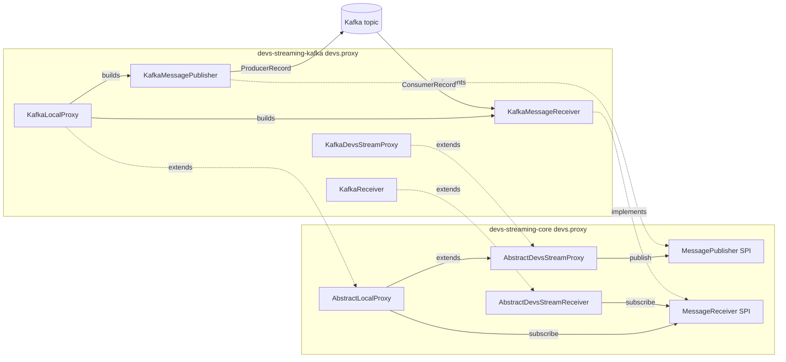

# Requirements

### Overview & Goals
Refactor the DEVS streaming proxy so the reusable, DEVS-facing "proxy" logic lives in `devs-streaming-core`, and only the Kafka wire-protocol code remains in `devs-streaming-kafka`. This introduces a small **transport SPI** in core so future transports (`devs-streaming-nats`, `devs-streaming-dds`) can be added by implementing two interfaces plus thin factories — with no re-implementation of DEVS proxy/coordination logic.

This plan implements the top-level approach already agreed in the prior analysis: split responsibilities along a clean transport SPI boundary.

**Follow-up refinement — external-library API must be preserved.** An earlier follow-up asked whether `KafkaReceiver` is redundant with `KafkaLocalProxy`. The two classes *do* duplicate the same Kafka *consumer* pipeline, but they serve **two different, both-needed usage patterns**, so neither class is deleted:
- **Split pattern (in-repo tests).** `KafkaDevsStreamProxyTest` wires each node as an outbound `KafkaDevsStreamProxy` plus a separate inbound `KafkaReceiver`.
- **Single-actor `SimulatorProvider` pattern (external libraries).** External libraries depend on `KafkaLocalProxy`, its nested `ProxyProperties`, and its `KafkaProxySimulatorProvider`. This bidirectional proxy is a *single* `AbstractBehavior<DevsMessage>` that behaves exactly like a `PDevsSimulator`/`PDevsCoordinator` when linked into a DEVS architecture: it forwards outbound messages from its parent coordinator to the transport **and** feeds remote responses back to the `localParentCoordinator` it learns dynamically from the `SimulationInitMessage`. The parent coordinator cannot tell whether the child is a local simulator or a remote proxy.

This plan therefore **preserves `KafkaLocalProxy` / `ProxyProperties` / `KafkaProxySimulatorProvider` as first-class, supported API** on top of the new SPI, and resolves the *real* redundancy — the duplicated Kafka consumer code — by consolidating it into a single SPI adapter (`KafkaMessageReceiver`) that both `KafkaReceiver` and `KafkaLocalProxy` use. The substitutability the external libraries rely on lives on two contracts that sit *above* the SPI and are left untouched: (1) the actor-message contract (`ActorRef<DevsMessage>` + the DEVS protocol) and (2) the `SimulatorProvider<T>` seam.

### Scope
**In Scope**
- New transport SPI in `devs-streaming-core`: `MessagePublisher` (outbound) and `MessageReceiver` (inbound).
- Reusable abstract Pekko actors in core that own all DEVS-specific behavior:
  - `AbstractDevsStreamProxy` (outbound: serialize + publish + terminate).
  - `AbstractDevsStreamReceiver` (fixed-target inbound: deserialize + `receiverId` filter + `SimulationInit` wrapping + forward to a fixed component + shutdown).
  - `AbstractLocalProxy` (bidirectional: extends `AbstractDevsStreamProxy` and *composes* a `MessageReceiver`; learns `localParentCoordinator` from the outbound `SimulationInitMessage` and forwards inbound remote responses back to it — the substitutable-as-a-simulator behavior).
- New Kafka adapters in `devs-streaming-kafka` implementing the SPI (`KafkaMessagePublisher`, `KafkaMessageReceiver`), with the single, shared Kafka consumer pipeline living in `KafkaMessageReceiver`.
- Refactor **all** existing proxy classes — `KafkaDevsStreamProxy`, `KafkaReceiver`, `KafkaLocalProxy`, and `KafkaDevsStreamProxyProvider` — into thin Kafka wrappers over the core bases.
- Preserve existing public API for **every** kept class: `KafkaDevsStreamProxy.create(...)`, `KafkaReceiver.create(...)`, `KafkaLocalProxy.create(ProxyProperties)`, the nested `KafkaLocalProxy.ProxyProperties` record, and `KafkaLocalProxy.KafkaProxySimulatorProvider` — so both `KafkaDevsStreamProxyTest` and the external libraries compile and behave unchanged.

**Out of Scope**
- Implementing an actual NATS or DDS transport (only enabling it structurally).
- Changing the DEVS message model / ISO-21175 JSON schema (`DevsMessage`, `DevsSimMessage`, `SimulationInitMessage`).
- Changing simulation semantics, coordinator logic, or the coupling/coordinator classes.
- Adding new Maven modules.
- Removing or renaming any existing proxy class; all four (`KafkaDevsStreamProxy`, `KafkaReceiver`, `KafkaLocalProxy`, `KafkaDevsStreamProxyProvider`) and the nested `ProxyProperties` / `KafkaProxySimulatorProvider` are retained.

### User Stories
- As a framework maintainer, I want the DEVS proxy logic centralized in core so that each new messaging technology only implements transport specifics.
- As a transport-library author, I want two clearly documented SPI interfaces so I can plug in a new backend without touching DEVS logic.
- As an external-library author, I want `KafkaLocalProxy` + `ProxyProperties` + `KafkaProxySimulatorProvider` preserved so my DEVS architectures keep treating a remote model as an ordinary child simulator — a single actor spawned through a `SimulatorProvider` that is indistinguishable from a local `PDevsSimulator`/`PDevsCoordinator`.
- As an existing Kafka user, I want the current `KafkaDevsStreamProxy` and `KafkaReceiver` split-pattern API to keep working unchanged.
- As a maintainer, I want the duplicated Kafka consumer pipeline consolidated into one place so there is a single inbound consumer implementation without deleting any public class.

### Functional Requirements
- Outbound (proxy): a proxy serializes a `DevsMessage` to ISO-21175 JSON via `DevsObjectMapper`; a `SimulationInitMessage` is serialized as its wrapped `SimulationInit`; the payload is handed to the transport publisher with a monotonically increasing sequence key. On `SimulationTerminate` / `ModelTerminated` the publisher is closed and the actor stops.
- Inbound (standalone receiver): received JSON payloads are deserialized to `DevsSimMessage`, filtered so only messages whose `receiverId` matches the receiver's `receiverId` are forwarded to a fixed target DEVS component; a received `SimulationInit` is wrapped into a `SimulationInitMessage(simulationInit, sender)` so the target learns its return path; on `SimulationTerminate` / `ModelTerminated` the inbound stream is shut down and the actor stops.
- Bidirectional (local proxy): a **single** actor forwards outbound `DevsMessage`s from its parent coordinator to the transport (same as the outbound proxy), captures its `localParentCoordinator` from the outbound `SimulationInitMessage`'s parent, and forwards inbound messages whose `receiverId` equals its `localComponentName` back to that `localParentCoordinator` (inbound `SimulationInit` is **not** wrapped on this path); on `ModelTerminated` it shuts down the inbound stream, and on terminate it closes the publisher and stops.
- Substitutability: because the local proxy is an `AbstractBehavior<DevsMessage>` spawned via a `SimulatorProvider`, a DEVS coordinator cannot distinguish it from a local `PDevsSimulator`/`PDevsCoordinator`; this property must be preserved exactly.
- Behavioral parity with the current `KafkaDevsStreamProxy` + `KafkaReceiver` + `KafkaLocalProxy` implementations must be preserved (message ordering, `receiverId` filtering, `SimulationInit` wrapping/return path, dynamic parent learning, termination).

### Non-Functional Requirements
- `devs-streaming-core` must NOT gain a dependency on `kafka-clients` or `pekko-connectors-kafka`; the SPI must expose only JVM/Pekko-neutral types (`String` payloads, `java.util.function.Consumer`, `ActorRef`).
- Replace `System.out`/`System.err`/`System.exit(1)` in the moved logic with SLF4J logging and safe actor termination, since core code must not kill the JVM.
- No behavior regression for the existing (Kafka-gated) tests.

# Technical Design

### Current Implementation
All proxy logic currently lives in `devs-streaming-kafka` under `devs.proxy`:
- `KafkaDevsStreamProxy<T>` (`AbstractBehavior<DevsMessage>`): outbound only. `onDevsMessage(...)` serializes with `DevsObjectMapper` (extracting `getSimulationInit()` for `SimulationInitMessage`), sends a `ProducerRecord<Long,String>` on `producerTopic` with a running `index` key, logs delivery, and on `SimulationTerminate`/`ModelTerminated` closes the producer and stops.
- `KafkaLocalProxy<T> extends KafkaDevsStreamProxy<T>`: adds an inbound Pekko-Kafka `Consumer.plainSource` stream; tracks `localParentCoordinator` from `SimulationInitMessage`; `processRecord(...)` deserializes to `DevsSimMessage`, filters on `receiverId == localComponentName`, and tells the parent. Also declares the `ProxyProperties` record and the `KafkaProxySimulatorProvider` (a `SimulatorProvider<T>`). Uses `System.out`/`System.err`/`System.exit(1)`.
- `KafkaReceiver` (`AbstractBehavior<DevsMessage>`): standalone consumer actor. Builds `ConsumerSettings` + `Consumer.plainSource`, deserializes each record to `DevsSimMessage`, filters on `receiverId`, wraps `SimulationInit` into `SimulationInitMessage(simulationInit, sender)`, forwards to `devsComponent`, and shuts down the stream on terminate.
- `KafkaDevsStreamProxyProvider<T>`: a `SimulatorProvider<T>` that spawns a `KafkaDevsStreamProxy`.

Shared contracts already in `devs-streaming-core`: `SimulatorProvider` (`devs`), `DevsMessage`/`DevsSimMessage`/`SimulationInit`/`SimulationInitMessage`/`SimulationTerminate`/`ModelTerminated` (`devs.iso`), `DevsObjectMapper`/`ConfigUtils` (`devs.utils`). `KafkaUtils` is Kafka-only. Core already depends on `pekko-actor-typed`, `pekko-stream`, Jackson, and Typesafe Config; it does not depend on Kafka.

**Usage findings.** In-repo, `KafkaDevsStreamProxyTest` is the only caller and uses the **split pattern**: each node gets an outbound `KafkaDevsStreamProxy` plus an inbound `KafkaReceiver` (e.g. `storageProxy`+`storageReceiver`, `generatorProxy`+`generatorReceiver`, `coordinatorProxy`+`coordinatorReceiver`). `KafkaLocalProxy` and `KafkaProxySimulatorProvider` are not instantiated in-repo, **but the user's external libraries depend on them** via the single-actor `SimulatorProvider` pattern, so they are treated as supported public API rather than dead code. The two inbound paths differ meaningfully: `KafkaReceiver` (lines 128-191) forwards to a *fixed* `devsComponent` and wraps inbound `SimulationInit` into `SimulationInitMessage(simulationInit, sender)`; `KafkaLocalProxy` (lines 202-284) forwards to a *dynamically-learned* `localParentCoordinator` (captured from `SimulationInitMessage.getParent()`) and does **not** wrap inbound `SimulationInit`. The genuine duplication is the Kafka `Consumer.plainSource` pipeline itself (KafkaReceiver lines 128-144, KafkaLocalProxy lines 150-170), which both share — this is what gets consolidated into `KafkaMessageReceiver`.

The `SimulatorProvider<T>` seam (`devs.SimulatorProvider`, returns `ActorRef<DevsMessage>` + `getModelIdentifier()`) is what makes `KafkaProxySimulatorProvider` substitutable for a `DevsSimulatorProvider` at architecture-assembly time. All references to these classes are confined to the Kafka module and its test in-repo, keeping the refactor localized.

### Key Decisions
- **Resolve the redundancy by consolidating the shared consumer, not by deleting a proxy.** The genuine duplication is the Kafka `Consumer.plainSource` pipeline that both `KafkaReceiver` and `KafkaLocalProxy` embed. Move it once into the `KafkaMessageReceiver` SPI adapter; both classes consume through it. Keep *both* DEVS-facing behaviors (fixed-target receiver vs. bidirectional local proxy) because both are used. Rationale: removes the real code duplication while preserving every public class. *(This supersedes both the earlier "remove `KafkaReceiver`" and the later "remove `KafkaLocalProxy`" ideas — neither is removed.)*
- **Preserve substitutability on two contracts.** The property that a coordinator cannot tell a local simulator from a remote proxy lives on (1) the actor-message contract (`ActorRef<DevsMessage>` + the DEVS protocol — the coordinator only ever holds `ActorRef<DevsMessage>`) and (2) the `SimulatorProvider<T>` seam (both `DevsSimulatorProvider` and `KafkaProxySimulatorProvider` return `ActorRef<DevsMessage>` and expose `getModelIdentifier()`). The transport SPI sits strictly *below* both, so both survive the refactor untouched. Rationale: this is exactly the interface the external libraries rely on.
- **Bidirectional base via composition, not a fat class.** `AbstractLocalProxy` extends `AbstractDevsStreamProxy` (reusing outbound serialize/publish/terminate) and *composes* a `MessageReceiver` for inbound; it does not re-implement any consumer. `AbstractDevsStreamReceiver` holds only a `MessageReceiver`. Rationale: reuse outbound logic and the shared SPI receiver so the eliminated duplication is not re-introduced.
- **SPI uses only `String` payloads + a `Consumer<String>` callback.** No Kafka types (`ProducerRecord`, `ConsumerRecord`, `DrainingControl`) leak into core. Rationale: keeps core free of transport dependencies and makes NATS/DDS adapters trivial.
- **Preserve public Kafka API for all retained classes.** Keep `KafkaDevsStreamProxy`, `KafkaReceiver`, `KafkaLocalProxy` (incl. nested `ProxyProperties` and `KafkaProxySimulatorProvider`), and `KafkaDevsStreamProxyProvider` names and their static `create(...)` / constructor signatures; they become thin wrappers. Rationale: `KafkaDevsStreamProxyTest` and the external libraries keep compiling and behaving unchanged.
- **Instrumentation split.** Generic timing/deserialize/dispatch logging moves to core using SLF4J; Kafka-specific metadata logging (partition/offset) stays in the Kafka publisher callback. `System.exit(1)` is replaced by SLF4J error logging plus graceful actor stop. Rationale: library code must never kill the host JVM.
- **Sequence key stays in the core proxy.** The outbound running `index` is tracked in the core base and passed to `MessagePublisher.publish(long sequence, String payload)`; transports may use or ignore it (Kafka uses it as the record key).

### Proposed Changes
**New in `devs-streaming-core` (package `devs.proxy`):**

1. `MessagePublisher` — outbound transport SPI.
2. `MessageReceiver` — inbound transport SPI.
3. `AbstractDevsStreamProxy<T extends SimTime>` — outbound base actor: owns `MessagePublisher`, `componentName`, `index`, shared `DevsObjectMapper`; implements `onDevsMessage` (serialize + publish + terminate handling).
4. `AbstractDevsStreamReceiver` — reusable standalone inbound receiver actor generalizing `KafkaReceiver`: holds a `MessageReceiver`, a fixed target `devsComponent`, a `sender`, and a `receiverId`; on construction calls `receiver.subscribe(...)`; for each payload deserializes to `DevsSimMessage`, filters on `receiverId`, wraps a `SimulationInit` into `SimulationInitMessage(simulationInit, sender)`, forwards to `devsComponent`, and shuts down on terminate.
5. `AbstractLocalProxy<T extends SimTime> extends AbstractDevsStreamProxy<T>` — bidirectional base generalizing `KafkaLocalProxy`: additionally holds a `MessageReceiver`, `localComponentName`, and `Optional<ActorRef<DevsMessage>> localParentCoordinator`. On construction it calls `receiver.subscribe(...)`. It overrides `onDevsMessage` to (a) capture `localParentCoordinator` from an outbound `SimulationInitMessage.getParent()`, (b) shut down the receiver on `ModelTerminated`, then (c) delegate to `super.onDevsMessage(...)` for the outbound publish/terminate. Its inbound handler deserializes each payload to `DevsSimMessage`, filters on `receiverId == localComponentName`, and forwards to `localParentCoordinator` (logging and dropping — never `System.exit` — if a message arrives before the parent is known). No inbound `SimulationInit` wrapping (matching current behavior).

**New in `devs-streaming-kafka` (package `devs.proxy`):**

6. `KafkaMessagePublisher implements MessagePublisher` — wraps `KafkaProducer<Long,String>` + `producerTopic`; `publish(sequence, payload)` sends a `ProducerRecord` with the delivery callback (timing + partition/offset log); `close()` closes the producer.
7. `KafkaMessageReceiver implements MessageReceiver` — the **single** Kafka consumer pipeline, shared by both `KafkaReceiver` and `KafkaLocalProxy`: wraps `ConsumerSettings` (random group id) + `Consumer.plainSource(Subscriptions.topics(...))`; on `subscribe(handler)` runs the stream mapping each record value to `handler.accept(value)` with the resuming supervision strategy, retaining `Consumer.DrainingControl` for `shutdown()`.

**Refactored in `devs-streaming-kafka` (all classes retained):**

8. `KafkaDevsStreamProxy<T> extends AbstractDevsStreamProxy<T>` — constructor builds a `KafkaMessagePublisher` and passes it to super; keeps `create(componentName, producerTopic, pekkoProducerConfig)`.
9. `KafkaReceiver extends AbstractDevsStreamReceiver` (or delegates to it) — builds a `KafkaMessageReceiver`; keeps `create(devsComponent, sender, receiverId, config, topic)`.
10. `KafkaLocalProxy<T> extends AbstractLocalProxy<T>` — constructor builds a `KafkaMessagePublisher` (outbound) **and** a `KafkaMessageReceiver` (inbound) from `ProxyProperties`, passing both to super; keeps the nested `ProxyProperties` record, the nested `KafkaProxySimulatorProvider`, and `create(ProxyProperties)` exactly as today. Only change beyond the base swap: `System.out`/`System.err`/`System.exit(1)` are removed (behavior now handled generically in core).
11. `KafkaDevsStreamProxyProvider<T>` — unchanged behavior; spawns the refactored `KafkaDevsStreamProxy`.

### Data Models / Contracts
```java
// devs-streaming-core : devs.proxy
public interface MessagePublisher {
    /** Publish a serialized DEVS message. sequence is a monotonically increasing key
        the transport MAY use (Kafka uses it as the record key) or ignore. */
    void publish(long sequence, String payload);
    void close();
}

public interface MessageReceiver {
    /** Begin delivering each raw received payload to handler. Called once at startup. */
    void subscribe(java.util.function.Consumer<String> handler);
    /** Stop/drain the underlying subscription. */
    void shutdown();
}
```
```java
// Core outbound base (behavioral sketch)
Behavior<DevsMessage> onDevsMessage(DevsMessage m) {
    String json = (m instanceof SimulationInitMessage<?> init)
        ? mapper.writeValueAsString(init.getSimulationInit())
        : mapper.writeValueAsString(m);
    publisher.publish(index++, json);
    if (m instanceof SimulationTerminate<?> || m instanceof ModelTerminated<?>) {
        publisher.close();
        return Behaviors.stopped();
    }
    return Behaviors.same();
}
```
```java
// Core bidirectional base (AbstractLocalProxy) behavioral sketch
// Outbound: capture parent, then delegate to the outbound base.
Behavior<DevsMessage> onDevsMessage(DevsMessage m) {
    if (m instanceof SimulationInitMessage<?> init) {
        localParentCoordinator = Optional.of(init.getParent());
    }
    if (m instanceof ModelTerminated<?>) {
        receiver.shutdown();
    }
    return super.onDevsMessage(m); // publish + terminate handling
}

// Inbound: subscribe(handler) at construction; handler runs:
void onInboundPayload(String payload) {
    DevsSimMessage in = mapper.readValue(payload, DevsSimMessage.class);
    if (localParentCoordinator.isEmpty()) {
        log.error("Message received before parent known; dropping: {}", payload);
        return; // no System.exit
    }
    if (in.getReceiverId().equals(localComponentName)) {
        localParentCoordinator.get().tell(in); // no SimulationInit wrapping here
    }
}
```

### File Structure
```
devs-streaming-core/src/main/java/devs/proxy/
    MessagePublisher.java            (new)
    MessageReceiver.java             (new)
    AbstractDevsStreamProxy.java     (new)
    AbstractDevsStreamReceiver.java  (new)
    AbstractLocalProxy.java          (new - bidirectional base)

devs-streaming-kafka/src/main/java/devs/proxy/
    KafkaMessagePublisher.java       (new)
    KafkaMessageReceiver.java        (new - single shared Kafka consumer)
    KafkaDevsStreamProxy.java        (refactor -> extends AbstractDevsStreamProxy)
    KafkaReceiver.java               (refactor -> extends/uses AbstractDevsStreamReceiver)
    KafkaLocalProxy.java             (refactor -> extends AbstractLocalProxy; keeps ProxyProperties + KafkaProxySimulatorProvider)
    KafkaDevsStreamProxyProvider.java(minor: unchanged public behavior)
```

### Architecture Diagram


### Risks
- **Preserving the `KafkaLocalProxy` public API**: `create(ProxyProperties)`, the nested `ProxyProperties` record (field names/order), and `KafkaProxySimulatorProvider` (constructor + `provideSimulator` + `getModelIdentifier`) must remain byte-for-byte compatible so the external libraries compile and wire the same way. Any signature drift breaks downstream integration — verify signatures explicitly.
- **Dynamic parent learning / ordering**: `AbstractLocalProxy` must capture `localParentCoordinator` from the outbound `SimulationInitMessage` before any inbound message is dispatched, exactly as today. Replacing the current `System.exit(1)`-on-early-message with log-and-drop is a deliberate, safer behavior change to call out.
- **Consolidated consumer semantics**: `KafkaMessageReceiver` must reproduce the current consumer configuration (random group id, resuming supervision strategy, earliest offset, `.log(...)`) so both `KafkaReceiver` and `KafkaLocalProxy` behave identically to before.
- **Generic bounds / type parameters**: `SimulationInitMessage<?>` handling in the proxy, receiver, and local proxy must preserve current generic behavior; keep the same raw/wildcard patterns used today to avoid compile issues.
- **Receiver startup timing**: current Kafka classes start the stream inside the constructor; the core base must call `receiver.subscribe(...)` at construction to preserve ordering guarantees.
- **`SimulationInit` sender wiring in the standalone receiver**: `AbstractDevsStreamReceiver` must reproduce `new SimulationInitMessage<>(simulationInit, sender)` exactly so coordinator wiring is unchanged.
- **Removing `System.exit(1)`**: `KafkaLocalProxy` currently hard-exits when a message arrives before the parent is known and on deserialization failure; the core `AbstractLocalProxy` replaces both with SLF4J logging + drop. `KafkaReceiver`'s `printStackTrace()`/error path is likewise replaced with SLF4J logging in `AbstractDevsStreamReceiver`. Call out that these are intentional, safer behavior changes.

# Testing

### Validation Approach
The existing Kafka integration test (`KafkaDevsStreamProxyTest`) is `@Disabled("Requires KAFKA instance")`, so it cannot be executed by the agent. Validation therefore focuses on: (a) the whole reactor still compiles, and (b) the refactored Kafka classes preserve their public API so the disabled test still compiles against them.

### Key Scenarios
- `mvn -q -pl devs-streaming-core -am compile` succeeds and core has no Kafka dependency introduced (SPI uses only `String`/`Consumer`/Pekko types).
- `mvn -q -pl devs-streaming-kafka -am test-compile` succeeds, proving `KafkaDevsStreamProxy.create(...)` and `KafkaReceiver.create(...)` retain the signatures used by `KafkaDevsStreamProxyTest`.
- The `KafkaLocalProxy` public API is confirmed unchanged: `create(ProxyProperties)`, the nested `ProxyProperties` record fields, and `KafkaProxySimulatorProvider` (constructor, `provideSimulator`, `getModelIdentifier`) keep identical signatures so the external libraries still compile against them.
- Full build `mvn -q -DskipTests package` (or reactor `install`) completes across all modules.

### Edge Cases
- `SimulationInitMessage` outbound serialization still emits the wrapped `SimulationInit` payload (not the wrapper).
- Inbound filtering still drops messages whose `receiverId` != the receiver's `receiverId`.
- Inbound `SimulationInit` is still wrapped into `SimulationInitMessage(simulationInit, sender)` before forwarding.
- Terminate path closes the publisher (outbound proxy) and shuts down the receiver stream (inbound receiver) and stops the actor.
- Local proxy inbound path forwards to the dynamically-learned `localParentCoordinator`, filters on `receiverId == localComponentName`, and does **not** wrap inbound `SimulationInit`.

### Test Changes
- No new tests are required by scope; keep `KafkaDevsStreamProxyTest` `@Disabled` and unchanged. The test uses only `KafkaDevsStreamProxy` and `KafkaReceiver`; since all classes (including `KafkaLocalProxy`) are retained with identical public API, no test changes are needed. The plan intends zero test changes.

# Delivery Steps

###   Step 1: Introduce transport SPI interfaces in devs-streaming-core
`devs-streaming-core` exposes two transport-neutral SPI interfaces under `devs.proxy` that carry only serialized `String` payloads.

- Create `MessagePublisher` with `void publish(long sequence, String payload)` and `void close()`.
- Create `MessageReceiver` with `void subscribe(java.util.function.Consumer<String> handler)` and `void shutdown()`.
- Add Javadoc documenting the contract (sequence key semantics, single `subscribe` at startup, `handler` receives raw ISO-21175 JSON strings).
- Ensure no Kafka/transport types are referenced; confirm `devs-streaming-core` gains no new dependencies.

###   Step 2: Implement reusable abstract proxy, receiver, and local-proxy actors in core
Core owns all DEVS-facing proxy behavior in `devs.proxy` via an outbound base, a fixed-target inbound base, and a bidirectional base — all depending only on the SPI.

- Create `AbstractDevsStreamProxy<T extends SimTime>` extending `AbstractBehavior<DevsMessage>`: hold `MessagePublisher`, `componentName`, running `index`, and a `DevsObjectMapper`; implement `onDevsMessage` to serialize (`SimulationInitMessage` -> `getSimulationInit()`, else the message), `publish(index++, json)`, and on `SimulationTerminate`/`ModelTerminated` call `publisher.close()` and `Behaviors.stopped()`.
- Create `AbstractDevsStreamReceiver` extending `AbstractBehavior<DevsMessage>` generalizing `KafkaReceiver`: hold a `MessageReceiver`, a fixed `devsComponent`, a `sender`, and a `receiverId`; on construction call `receiver.subscribe(...)`; deserialize each inbound payload to `DevsSimMessage`, filter on `receiverId`, wrap `SimulationInit` into `SimulationInitMessage(simulationInit, sender)`, forward to `devsComponent`, and call `receiver.shutdown()` + `Behaviors.stopped()` on terminate.
- Create `AbstractLocalProxy<T extends SimTime> extends AbstractDevsStreamProxy<T>` generalizing `KafkaLocalProxy` (the substitutable-as-a-simulator, bidirectional actor): additionally hold a `MessageReceiver`, `localComponentName`, and `Optional<ActorRef<DevsMessage>> localParentCoordinator`; call `receiver.subscribe(...)` at construction; override `onDevsMessage` to capture `localParentCoordinator` from an outbound `SimulationInitMessage.getParent()`, shut down the receiver on `ModelTerminated`, then delegate to `super.onDevsMessage(...)`; in the inbound handler deserialize to `DevsSimMessage`, filter on `receiverId == localComponentName`, and forward to `localParentCoordinator` (log-and-drop — never `System.exit` — if the parent is not yet known; do not wrap inbound `SimulationInit`).
- Move generic timing/deserialize/dispatch logging into these bases via SLF4J; replace `System.out`/`System.err`/`System.exit(1)`/`printStackTrace()` with SLF4J logging plus graceful actor stop.

###   Step 3: Implement Kafka SPI adapters in devs-streaming-kafka
`devs-streaming-kafka` provides the transport-specific implementations of the core SPI under `devs.proxy`.

- Create `KafkaMessagePublisher implements MessagePublisher`: build/hold `KafkaProducer<Long,String>` (via `KafkaUtils`/`ConfigUtils`) and `producerTopic`; `publish(sequence, payload)` sends a `ProducerRecord<>(producerTopic, sequence, payload)` with the existing delivery callback (send-time latency + partition/offset logging); `close()` closes the producer.
- Create `KafkaMessageReceiver implements MessageReceiver` (the **single** shared Kafka consumer used by both `KafkaReceiver` and `KafkaLocalProxy`): build `ConsumerSettings` with a random group id, run `Consumer.plainSource(settings, Subscriptions.topics(topic))` mapping each record value to `handler.accept(value)` with the resuming supervision strategy and `log(...)`, materialized to a `Consumer.DrainingControl`; `shutdown()` drains/shuts down the stream.
- Keep all Kafka/Pekko-Kafka imports confined to these two classes.

###   Step 4: Refactor all Kafka classes to thin wrappers (no deletions) and verify the build
Every Kafka proxy class becomes a thin adapter over the core bases while keeping its exact public API, and the reactor compiles.

- Refactor `KafkaDevsStreamProxy<T>` to extend `AbstractDevsStreamProxy<T>`, constructing a `KafkaMessagePublisher` and passing it to super; keep `create(componentName, producerTopic, pekkoProducerConfig)`.
- Refactor `KafkaReceiver` to extend/delegate to `AbstractDevsStreamReceiver` using a `KafkaMessageReceiver`; keep `create(devsComponent, sender, receiverId, config, topic)`.
- Refactor `KafkaLocalProxy<T>` to extend `AbstractLocalProxy<T>`, constructing a `KafkaMessagePublisher` (outbound) and a `KafkaMessageReceiver` (inbound) from `ProxyProperties` and passing both to super; keep the nested `ProxyProperties` record, the nested `KafkaProxySimulatorProvider`, and `create(ProxyProperties)` with identical signatures. Remove the now-unneeded `System.out`/`System.err`/`System.exit(1)` and the inline consumer stream.
- Leave `KafkaDevsStreamProxyProvider` behavior unchanged.
- Verify with `mvn -q -pl devs-streaming-core -am compile`, `mvn -q -pl devs-streaming-kafka -am test-compile` (confirming `KafkaDevsStreamProxyTest` still compiles), and a full `mvn -q -DskipTests package`; also re-check that `KafkaLocalProxy.create(ProxyProperties)`, `ProxyProperties`, and `KafkaProxySimulatorProvider` keep identical signatures for the external libraries.