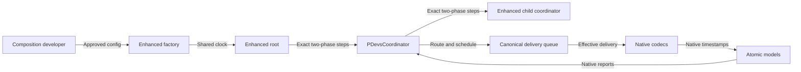

# Requirements

### Scope and completed baseline
The documentation/OpenAPI revision is complete. Extend the plan to implement time semantics in the existing `PDevsCoordinator` (the repository's spelling), root/factory integration, supporting core time/configuration/routing classes, and Java tests.

Preserve the completed supplier-only OpenAPI contract and complete removal of `conversionPolicy`, `roundingMode`, and `maxAbsErrorSeconds`. Update `docs/time-semantics/time-semantics.md` and `README.md` to describe actual runtime support.

No ISO 21175-2 schema changes, composition endpoints, external DTO/UI or generated-client changes, or new transport profiles. Coordinator-owned wall-clock pacing, scaled-time gates, lag detection, and catch-up policies are explicitly deferred.

### Responsibility split
- **Model supplier:** declares native clock facts and supported timestamp representations.
- **Composition/coordinator developer:** supplies alignment, conversion, delivery adaptation, rounding, and timing-error budgets; approves suitability for the intended purpose.
- **Enhanced `PDevsCoordinator`:** executes the approved configuration deterministically without selecting policies or assessing modeling validity. Malformed-value, overflow, and synchronization safeguards remain legitimate.

### Required runtime behavior
- Enhanced coordination uses exact rational seconds plus distinguished logical infinity internally; subordinate models retain native representations.
- `quantum` describes accepted local timestamp lattice spacing, not simply minimum internal time advance.
- Rational arithmetic does not remove target representability or quantization constraints.
- Next-representable-time adaptation queues input until its effective target time while continuing intervening events. Actual source event time remains distinct from effective delivery time.
- Error-budget monitoring/enforcement is optional and explicitly configured.
- Legacy common-time execution may omit semantics. Enhanced execution requires complete developer-supplied execution configuration, supplied outside this model-library API.
- Enhanced simulations contain only enhanced coordinators, including the root, sharing exact rational seconds, distinguished infinity, and one composition origin. Native atomic models may remain heterogeneous.
- Introduce rational-valued `QuantizedSimTime` for coordinator-to-coordinator messages. Its denominator is not a model's timestamp lattice; no common lattice is imposed on coordinators.
- Deprecate legacy common-time creation/constructor paths, not the enhanced class; retain them for separate legacy simulations and reject enhanced/legacy coordinator mixing.
- Parent contracts are explicit but fixed to the shared enhanced clock. No parent scheduling rounding or coarse-parent catch-up is needed.
- Preserve model-internal pacing and wait-for-completion behavior. Do not promise wall-clock deadlines or recovery when models run slower than real time.
- Canonical rational time alone requires no ISO message-format change. Existing external boundaries retain supported native encodings; unsupported rational export must fail explicitly.
- Completely remove `conversionPolicy`, `roundingMode`, and `maxAbsErrorSeconds` from the OpenAPI specification; do not retain optional or deprecated versions. Composition adaptation remains outside the supplier API.

# Technical Design

### Current implementation
Java 21, Pekko typed actors, Jackson, Immutables, and Maven are established by the parent/core POMs; follow these patterns without adding an arithmetic dependency.

- `devs-streaming-core/src/main/java/devs/PDevsCoordinator.java`: native `T` is shared by all children. `getNextTime`/`buildImminentModels` compare native values; initialization/dispatch reuse parent time. `onOutputReport` immediately executes transitions, and `onTransitionComplete` uses the last responding child's event time.
- `RootCoordinator.java`: drives steps directly from output reports; there is no coordinator-owned wall-clock throttling.
- `CoupledModelFactory.java`/`SimulatorProvider.java`: providers share one initial-time type. Use typed child bindings rather than unchecked heterogeneous provider casts.
- `PDevsCouplings.java`/`OutputCouplingMessages.java`: static/dynamic routing merges bags by receiver, losing source-route identity needed by per-interaction rules.
- `PDevsSimulator.java`: already separates output generation from internal/external/confluent transitions. Its initialization needs to align `timeLast` with the supplied native initial time for mapped nonzero origins.
- `iso/time/SimTime.java` and long/double implementations provide type-specific arithmetic/comparison and maximum-value sentinels. New internal types must not silently become ISO wire profiles.
- `proxy/AbstractDevsStreamProxy.java` directly serializes outgoing messages; unsupported rational export needs an explicit guard.
- Existing JUnit/Pekko tests in `PDevsCoordinatorTest.java`, `RootCoordinatorTest.java`, and `simulation/PDevsSimulationTest.java` provide actor-probe and integration patterns. Preserve legacy coverage.

The completed OpenAPI 3.1 contract already separates native facts from composition rules; its migration constraints remain in force.

### Agreed architecture
Enhance `PDevsCoordinator` in place through explicit enhanced entry points and a testable canonical scheduling helper; preserve legacy execution behind deprecated entry points. Every enhanced root/coordinator receives a shared immutable clock context and composition origin through local construction/initialization, not new wire fields. Enhanced child coordinators use the canonical identity mapping; native model bindings supply codecs, native facts, and alignment. Reject incomplete configuration or clock-context disagreement without assessing modeling suitability.

### Exact time and native boundaries
- Add `devs/time/Rational.java`: normalized `BigInteger` numerator/positive denominator, exact arithmetic, ordering, lattice membership, and ceiling operations.
- Add `devs/iso/time/QuantizedSimTime.java`: immutable rational-valued `SimTime` with distinguished infinity, consistent equality/hash/order, and explicit infinity arithmetic that rejects indeterminate operations. Its denominator does not declare a model quantum.
- Add native-only `TimeSemantics`, typed `NativeTimeCodec<N extends SimTime>`, and `TimeMapping` under `devs/time/`, with concrete long/double codecs and explicitly supplied codecs for other native types. Provide an exact decimal codec/local decimal time implementation where required for decimal-native support, following existing Immutables conventions; this does not authorize a new external encoding.
- Decode doubles as their exact binary values, not rounded display decimals. Reject NaN, malformed infinity, sentinel collisions, range overflow, and unsupported encodings. Validate encoding round trips.
- Map finite values using `canonical = alignmentOffset + originOffset + unitSeconds * local`. Validate positive units/quantum and required discrete quantum; decode sentinels before affine arithmetic. Preserve existing native long/double behavior and payloads.
- Exact delivery requires both encoding representability and lattice membership. Next-representable delivery finds the earliest timestamp satisfying both at or after source time, not unchecked rounding after lattice ceiling. Fail when no timestamp is representable within range; never silently schedule into the past.

### Developer configuration and typed construction
- Add immutable `CoordinatorExecutionConfig`, `EnhancedClockContext`, `DeliveryRule`, `InteractionKey`, optional `TimingErrorBudget`, and typed `ChildBinding<N>` under `devs/time/`. Supply native reference/sentinel details, per-interaction policies, alignment, deterministic bag ordering, and optional budget metric/violation actions.
- Implement explicit `EXACT` and `NEXT_REPRESENTABLE` strategies; any supplied extension strategy must obey causality/representability guards. No automatic adaptation or inference from supplier OpenAPI fields.
- Extend `CoupledModelFactory.java` with enhanced construction and heterogeneous typed bindings. Each native `SimulatorProvider<N>` receives its own mapped initial time; nested enhanced factories receive canonical time. Keep existing provider signatures intact.
- Extend local `SimulationInitMessage.java` with an optional enhanced context and backward-compatible constructor overload; its wrapper is not the ISO payload. Enhanced root/coordinator initialization verifies mode/context; legacy coordinator paths reject enhanced context. Propagate context to enhanced coordinator children only, not native atomic models. Direct actor-ref construction also requires explicit child-kind bindings.
- Deprecate legacy root/coordinator/factory common-time construction paths while retaining behavior for legacy runs. Do not deprecate atomic simulators or the enhanced class itself.

### Source-aware routing and queued scheduling
- Extend `PDevsCouplings.java`/`OutputCouplingMessages.java` with additive `RoutedDelivery` results: source model/port, target model/port, and transformed value. Preserve current bag APIs and static/dynamic resolver behavior, duplicate routes, and stable configured ordering.
- Add `CanonicalSchedule.java` and `PendingDelivery.java` under `devs/time/`. Retain source time, effective time, native target timestamp, route identity, and deterministic tie-break key internally. Order native candidate events and queued effective deliveries together.
- Process the `1.5 ms` source, intervening `1.75 ms` event, and `2 ms` delivery as separate canonical steps. Infinity-only candidates cannot hide a finite queued delivery.
- Enhanced `RequestOutput` collects only imminent child outputs and reports upward without executing transitions. Delivery-only steps complete output collection immediately with an empty bag.
- Enhanced `ExecuteTransition` merges due deliveries, current routed output, and same-time parent inputs before one dispatch per target. Imminent targets without input receive internal transitions; targets with input at their next event receive confluent transitions through existing simulator behavior. Nested enhanced coordinators follow this same two-phase protocol.
- Update state from the active canonical step, never the last responding child's event time. Wait for expected responses; guard unexpected senders, duplicate/stale responses, inconsistent native timestamps, and rollback. Preserve equal-time/zero-advance steps instead of inventing increments.
- Invoke budget observation/enforcement only when explicitly configured, using developer-defined encoding-error/displacement metrics and actions. Preserve source/effective times internally without new ISO metadata.

### Root, lifecycle, and pacing
- Enhanced `RootCoordinator` handles `TransitionComplete`: request output, send `ExecuteTransition` after output collection, and advance only after transition completion. Check the exact horizon from the first candidate onward and never execute logical infinity.
- Map initialization into each native clock and initialize simulator `timeLast` consistently. Terminate native children at their last valid local time rather than an off-lattice global timestamp; clear pending delivery state and complete lifecycle acknowledgments.
- Preserve `StepTimingTracker` instrumentation across new phases and delivery-only steps; wall-clock timing statistics are not modeling error budgets.
- Retain model-owned pacing and acknowledgement waits. Add no pacing timer, sleep, factor application, wall-clock gate, or lag policy. Document that a slow model can cause execution to fall behind wall clock.

### File updates and compatibility
Modify core `src/main/java/devs/`: `PDevsCoordinator.java`, `RootCoordinator.java`, `CoupledModelFactory.java`, `PDevsCouplings.java`, `OutputCouplingMessages.java`, `PDevsSimulator.java`, and `iso/SimulationInitMessage.java`. Add the time/configuration/scheduling classes above. Update `iso/time/SimTime.java` subtype metadata or `utils/DevsObjectMapper.java` only if needed for local exact-type serialization, preserving existing formats.

Add a native-profile guard in `proxy/AbstractDevsStreamProxy.java` covering all timestamp fields, including next-time fields and wrapped initialization, before publishing unsupported rational values. Native model proxy traffic remains unchanged. Enhanced coordinator-to-coordinator external transport is unsupported until a separately agreed exact wire profile exists.

Update `docs/time-semantics/time-semantics.md` and `README.md` with configuration examples, actual conformance, enhanced-only hierarchy, legacy deprecation, native boundary limits, and future pacing work. Preserve the completed OpenAPI behavior; change explanatory descriptions only if needed, never restore supplier adaptation fields or add composition configuration. No new Maven dependency is expected.

### Runtime flow

### Migration limits
Supplier adaptation fields remain completely removed, not optional/deprecated. Existing clients may need regeneration and DTO/UI/validator updates; only nested `TimeMode.timeSemantics` remains deprecated. Positivity constraints intentionally reject invalid values; retain permissive unknown-property behavior and unrelated endpoints/formats. Legacy Java entry points remain available with deprecation warnings, but mixing coordinator modes in enhanced execution is rejected. Runtime implementation is now included; external consumers and exact external coordinator transport are not automatically migrated.

# Testing

### Contract validation
Retain the completed YAML/OpenAPI 3.1/payload validation baseline and revalidate if the specification changes. Add permanent Java tests for runtime behavior using existing JUnit/Pekko patterns.

### Positive and negative cases
- Full `StartModelRunRequest` with its existing required initialization/Kafka fields and pacing-only `real-time` or `virtual-time` configuration passes without semantics.
- Scaled pacing with positive factor passes without semantics; missing, zero, or negative factor fails.
- Native semantics without any adaptation property passes.
- Confirm `conversionPolicy`, `roundingMode`, and `maxAbsErrorSeconds` are absent everywhere in the OpenAPI file, including properties, required lists, conditionals, descriptions, and examples; confirm removed enum schemas have no dangling references.
- Do not claim old adaptation-bearing payloads must fail schema validation: existing permissive additional-property behavior remains unchanged.
- Discrete semantics without `quantum` fails; positive lattice spacing passes; zero or negative spacing fails.
- Zero/negative `unitSeconds` and denominator below one fail; zero/negative native epoch offsets remain valid.
- New top-level catalog/context semantics and deprecated nested semantics remain schema-valid. Conflict reporting is a documented application responsibility, not falsely claimed to be enforced by JSON Schema.
- `CurrentSimulationTime` preserves its existing required fields and encoded string value.

### Consistency and completion report
Compare runtime terminology, examples, lifecycle guidance, and implemented conformance with documentation. Preserve OpenAPI endpoints, unrelated required lists, ISO schemas, and native payload formats. Report runtime/contract results separately, including external rational transport limits and deferred coordinator pacing.

### Runtime scenarios and test files
- Add `src/test/java/devs/time/` arithmetic/codec/configuration/schedule tests and `devs/msg/time/QuantizedSimTimeTest.java`: normalization, negative/large offsets, infinity, invalid units/lattices, overflow, binary-double precision, decimal round trips, and encoding/lattice next-representability boundaries.
- Extend `PDevsCoordinatorTest.java` or add `PDevsCoordinatorTimeSemanticsTest.java`: mixed native types, completeness guards, per-route rules, explicitly optional budget actions, deterministic replay despite response-order changes, stale/unexpected reports, and rollback prevention.
- Cover queued `1.5 ms` to `2 ms` delivery with an intervening `1.75 ms` event, delivery-only steps, infinity candidates plus queued input, simultaneous internal/confluent events, duplicate routes, external-only steps, and zero advance.
- Extend `RootCoordinatorTest.java` and `simulation/PDevsSimulationTest.java`; add factory tests for nested simultaneous parent input, shared-origin agreement, legacy coordinator rejection, heterogeneous provider initialization, nonzero epochs, horizon/infinity termination, and pending deliveries beyond end time.
- Add source-aware routing tests through static/dynamic resolvers; preserve legacy coordinator, simulator, and timing tracker regressions.
- Use delayed probe replies to verify no advance before completion, without new pacing timers or sleep-based timing assertions.
- Add proxy guard tests: unchanged native JSON and no publish on unsupported rational timestamps. Run core Maven tests and dependent-module compilation; run relevant Kafka/observation regressions when required services are available and report skipped checks explicitly.

# Delivery Steps

### ✓ Step 1: Implement exact time, native codecs, and execution configuration
Canonical time and explicit model-boundary mappings can be constructed without selecting composition policies.
- Add `Rational`, `QuantizedSimTime`, native semantics/codecs, mappings, delivery rules, optional budget contracts, and shared clock context in core time packages.
- Implement exact decoding, infinity handling, affine alignment, encoding/lattice checks, and exact/next-representable strategies.
- Support long/double and exact local decimal/custom codecs without changing native wire profiles.
- Add arithmetic, malformed-value, overflow, and configuration completeness tests.

### ✓ Step 2: Add enhanced-only hierarchy construction and migration paths
Factories initialize heterogeneous native children and enhanced coordinator children with the correct contracts.
- Extend `CoupledModelFactory` using typed `ChildBinding` and enhanced creation paths.
- Add local context to `SimulationInitMessage`; validate shared clock/origin and reject legacy coordinator mixing.
- Preserve provider signatures and deprecate legacy root/coordinator/factory common-time entry points.
- Align `PDevsSimulator.timeLast` with mapped initialization and test mixed provider types and nonzero origins.

### ✓ Step 3: Implement source-aware routing and canonical queued scheduling
`PDevsCoordinator` orders child events and adapted input deliveries exactly and deterministically.
- Add source-aware results to `PDevsCouplings`/`OutputCouplingMessages` while preserving current bag APIs.
- Implement `CanonicalSchedule`/`PendingDelivery`, per-route rule application, distinct source/effective times, and optional budget actions.
- Convert child reports to canonical time and dispatch native times without cross-type comparison or unchecked conversion.
- Test off-lattice input, intervening events, delivery-only steps, encoding constraints, deterministic ties, and infinity candidates plus queued input.

### ✓ Step 4: Implement hierarchical two-phase execution and exact root lifecycle
Enhanced root and nested coordinators collect output before dispatching merged inputs and confluent transitions.
- Separate enhanced `RequestOutput` from `ExecuteTransition` in `PDevsCoordinator`, preserving its legacy branch.
- Merge due deliveries, current routed output, and parent input once per target; use canonical active-step time for state and acknowledgments.
- Update `RootCoordinator` to await `TransitionComplete` and handle initial horizon/infinity checks.
- Complete native termination mapping, queue cleanup, response/synchronization guards, and timing instrumentation.
- Test nested simultaneous events, zero advance, delayed replies, stale responses, termination, and legacy regressions; add no pacing gates.

### ✓ Step 5: Enforce transport boundaries and document runtime support
The enhanced implementation has explicit native-wire limits and configuration/migration guidance.
- Add `AbstractDevsStreamProxy` guards against unsupported rational export; verify native payloads are unchanged.
- Add local exact-type serialization support only where needed in `SimTime`/`DevsObjectMapper`, with round-trip tests.
- Update `docs/time-semantics/time-semantics.md` and `README.md` with configuration examples, implemented conformance, enhanced-only hierarchy, legacy deprecation, and model-owned pacing limits.
- Preserve the completed OpenAPI contract and removed supplier adaptation fields; revalidate if descriptions change.
- Run core tests and dependent-module compilation/regressions as available; report actual results and deferred external transport/pacing limitations.