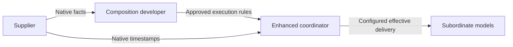

# Time Semantics

## Purpose

This document describes the supplier-native contract and implemented, locally configured enhanced coordination in the Java core, with three distinct authorities:

1. **Model supplier:** declares native clock facts and supported timestamp representations.
2. **Composition/coordinator developer:** chooses timeline alignment and codecs (including decimal adaptation resolution), optionally configures timing-error budgets, and MUST validate adaptation suitability for the intended purpose **before coupling**.
3. **Enhanced `PDevsCoordinator`:** executes codec-owned upward input adaptation deterministically; it does not assess modeling validity or select per-route policies.

Malformed-value, overflow, and synchronization safeguards remain legitimate runtime checks, not composition-validity assessments. Pacing (execution speed relative to wall clock) is independent of native logical-time meaning.

Enhanced execution is opt-in through `CoupledModelFactory.enhanced()`, `PDevsCoordinator.enhanced()`, and `RootCoordinator.enhanced()`. Deprecated legacy factory constructors and coordinator/root entry points remain available for separate common-time simulations; they do not acquire enhanced conversion or delivery semantics. Coordinator nodes in an enhanced hierarchy must all be enhanced.

---

## Conceptual Model

Each subordinate model retains its local logical time axis `t_local` and native representation. Enhanced coordination uses `QuantizedSimTime`: exact normalized `Rational` seconds plus a distinguished logical-infinity value internally. Despite its name, it imposes no common coordinator lattice or fixed tick size; lattice constraints belong to individual native clocks.

For finite values, a conceptual mapping is:

- `t_reference = originOffset + unitSeconds * t_local`
- `t_canonical = alignmentOffset + t_reference`
- `t_local = (t_canonical - alignmentOffset - originOffset) / unitSeconds`

`unitSeconds` is positive. `originOffset` is a supplier-native epoch declaration in rational seconds relative to a supplier-documented reference; it may be zero or negative. `alignmentOffset` is a separate composition-developer decision aligning that reference with the composition timeline, not a supplier API field. All these mapping quantities are exact rationals.

In Java, `TimeSemantics.secondsPerUnit()` corresponds to `unitSeconds`, `origin()` to `originOffset`, and `TimeMapping.alignment()` to `alignmentOffset`. `EnhancedClockContext(clockId, compositionOrigin)` identifies the shared clock and reference origin for the entire enhanced hierarchy. Both fields must agree between coordinator nodes. The context does not automatically add its origin to native conversion: the developer supplies each affine mapping explicitly, without counting the shared origin twice.

Java declares an optional supplier restriction through `Optional<TimeGranularity> timeGranularity`. When present, accepted finite local timestamps lie on the native-zero grid `t_local = k * spacing` for integer `k`, subject also to native encoding range and representation limits. The spacing is in native units; its spacing in seconds is `unitSeconds * spacing`. Origin and alignment map this grid onto the canonical timeline without changing its native-zero anchor.

Absence means no additional supplier-imposed grid, not unlimited representability: integer, finite decimal, and binary floating-point codecs still constrain values. Declare granularity when off-grid timestamps are unsupported, whether the model throws exceptions, silently rounds, or produces wrong behavior. Granularity is not a minimum internal time advance, tolerance, or common coordinator tick; neither a discrete domain nor an integer codec alone requires an additional declared grid.

Decode a native infinity sentinel using the declared `infinityPolicy` and supplier-documented sentinel details before finite arithmetic. Canonical logical infinity orders after every finite time, means no finite candidate event, and is never treated as an ordinary maximum-number operand in affine conversion. Encode it explicitly when returning to a native representation; ambiguous or malformed sentinel values are runtime errors.



---

## Contract

## `TimeMode`

`TimeMode` describes runtime pacing:

- `real-time`
- `scaled-real-time`
- `virtual-time`

`scaled-real-time` requires `realTimeFactor > 0`.

## `TimeSemantics`

`TimeSemantics` describes supplier-native facts only:

- `timeDomain`: `discrete | continuous`
- `valueEncoding`: `int64 | decimal-string | float64`
- `unitSeconds`: rational seconds per 1 local time unit
- `timeGranularity`: optional positive rational accepted timestamp grid spacing in native units, anchored at native zero
- `originOffset`: rational seconds from the supplier-documented reference epoch to local zero
- `infinityPolicy`: `max-finite | string-sentinel`

Alignment, codec selection and adaptation resolution, and optional timing-error budgets belong to developer-supplied execution configuration outside this model-library API. They are not supplier `TimeSemantics` properties. The developer supplies native reference/sentinel details and supported codecs, and validates the suitability of their automatic upward adaptation before coupling; no per-route delivery rule is required.

Legacy common-time execution may omit semantics. Enhanced execution requires complete, approved developer-supplied configuration, but this API does not define that configuration's transport or add composition endpoints.

## Invariants

- Rational denominators must be `>= 1`.
- `unitSeconds` and any supplied `timeGranularity` must have positive numerators; native epoch offsets may be zero or negative.
- `timeGranularity` is optional independently of `timeDomain` and `valueEncoding`; when absent, codec constraints still apply.
- `TimeMode.mode=scaled-real-time` requires a positive `realTimeFactor`; any supplied factor must be positive.
- Native target representability and timestamp lattices apply even when canonical conversion is rational and exact.
- Timing-error monitoring or enforcement is optional and must be explicitly configured by the developer.

---

## OpenAPI Reflection

The local contract is `../../../sim-model-library/docs/time-semantics-open-api-spec.yaml` (OpenAPI `3.1.0`, metadata contract version `2.0.0`):

- Native schemas: `TimeDomain`, `TimeValueEncoding`, `TimeInfinityPolicy`, `RationalTime`, `TimeSemantics`.
- Pacing schemas: `TimeModeType`, `TimeMode`; only `mode` is always required in `TimeMode`, and scaled pacing additionally requires a positive `realTimeFactor`.
- `ModelSummary.timeSemantics` and `Model.timeSemantics` optionally declare supplier-native facts independently of pacing.
- `SimulationContext.timeSemantics` optionally identifies an expected supplier-supported contract. It cannot redefine the native clock or supply composition adaptation.
- `TimeMode.timeSemantics` remains optional and deprecated solely for migration.
- `CurrentSimulationTime.value` remains an encoded string with its existing required fields (`value`, `sourceMessageType`, `updatedAt`). Optional semantics describe that reported native value, not canonical scheduling time. Optional `timeType` (`long`, `double`, `decimal`) and `wireProfile` identify native reports; new decimal reports require `timeType: decimal`, `wireProfile: devs-exact-time-v1`, and supplier `decimal-string` semantics. Canonical rational status is not a native encoding.

Present metadata is a direct rational object, for example `"timeGranularity": {"numerator": 1, "denominator": 1000}`, not a nested `spacing` object. Omit `timeGranularity` when absent; null is invalid. Obsolete `quantum` is rejected and has no alias. The Java wrapper `TimeGranularity.of(Rational.of(1, 1000))` is a construction API, not the metadata JSON shape.

Conflicting catalog, context, or deprecated nested declarations must be reported, not silently resolved by precedence. This is an application responsibility: JSON Schema does not enforce agreement between declarations or with supplier support. No new diagnostic response format or endpoint is specified.

Canonical rational time is used for local enhanced execution and can now be serialized for explicitly configured compatible transport/recording. Native remote decimal models use their own decimal timestamps at mapped boundaries. The separately identified framework [exact-v1 profile](exact-time-wire-v1.md) and [v2 message schema](../devs-messages-v2.schema.json) extend JSON timestamp support without widening the numeric ISO-derived baseline or supplier-native metadata.

---

## External DTO, Server, and UI Integration

Earlier integration references concern external model-library projects, not verified implementations in this repository:

- DTOs under `model-library-server-java/src/main/java/iso/sim/server/dto/run/`, such as `TimeModeDto`, `TimeSemanticsDto`, `RationalTimeDto`, and `CurrentSimulationTimeDto`.
- The external specification under `model-library-server-java/src/main/resources/open-api/model-libary-open-api-spec.yaml`.
- Monitoring in `model-library-server-java/src/main/java/iso/sim/server/service/KafkaIsoRunMonitor.java`.
- UI integration under `model-library-ui/src/app/models/run-config-dialog/` and `model-library-ui/src/app/services/model.service.ts`.

Those consumers must be reviewed separately for native metadata, pacing, encoded-value handling, validation, and migration. This document does not verify their DTO invariants, `BigDecimal` parsing, rollback safeguards, status handling, or UI capabilities. Neither carrying semantics in a server nor parsing values as decimals implements canonical rational scheduling or establishes composition validity. No DTO, server, UI, or generated-client changes are included here.

---

## Coordinator Conversion and Coordination Strategy

The following describes implemented local execution APIs. They are not configuration endpoints or generated OpenAPI DTOs.

## 1) Developer preparation and approval

The composition developer collects supplier-native facts, resolves native reference epochs and sentinel definitions, chooses alignment and codecs, and checks representability for intended interaction paths. The developer MUST validate the suitability of automatic codec-owned upward adaptation, including decimal adaptation resolution, delivery displacement, and model-owned confluent behavior, **before coupling**. Optional timing-error budgets do not replace this approval. Native facts and runtime safeguards alone do not establish modeling validity; the coordinator performs no modeling validation.

## 2) Load approved execution configuration

`CoordinatorExecutionConfig` is a record carrying only `clock` and `Map<InteractionKey, TimingErrorBudget> timingErrorBudgets`, not child order. `new CoordinatorExecutionConfig(clock)` defaults to an empty optional monitoring map; `new CoordinatorExecutionConfig(clock, budgets)` takes an immutable snapshot of supplied monitors. Routes need no rule or budget entry. Coordinator/factory construction resolves child order independently and validates unique child identifiers, exact child coverage, binding identifiers, and declared coordinator clocks. `TimeSemantics` checks positive units and requires a non-null `Optional<TimeGranularity>`; `TimeGranularity` checks positive rational spacing. Use `TimeSemantics.of(scale, origin)` for absence, or `TimeSemantics.of(scale, origin, Optional.of(TimeGranularity.of(spacing)))` for presence. The factory's `create(initialTime)` checks exact native representability and any declared grid membership of the canonical initial time before spawning children; initialization is never adapted.

### Construction-time child ordering (both execution modes)

Legacy and enhanced coordinator/factory APIs without an order argument use child identifiers sorted by Java natural, case-sensitive `String` order (for example, `"A"` precedes `"a"`). Map and provider/binding insertion order do not select the order. Custom-order overloads take an explicit `List<String> childOrder` before the optional `StepTimingTracker` or factory tracker supplier. Legacy direct coordinator constructors place the list after the actor context; the existing full direct constructor retains its argument layout and adds a trailing list overload.

An explicit list must cover every child exactly once. Null lists/elements, blank entries, duplicates, missing children, and unknown children are rejected; identifiers are never normalized. The resolved sequence is defensively copied into an immutable construction-time snapshot, so caller mutations cannot change later factory creation, coordinator behavior, or schedule imminence.

The same resolved order controls initialization sends, imminent output requests, source-output routing, transition sends, and termination in both modes. Bag assembly preserves each child's output-list order and coupling/resolver target order, independently of output-report arrival order. This controls coordinator sends and bag assembly, **not** cross-actor execution or completion order. Actors are not serialized; phase barriers and model-owned confluence remain unchanged, and there is no whole-run reproducibility guarantee.

Legacy behavior intentionally changes from incidental map order and recipient-first/internal-second dispatch: output-driven transitions now visit the union of recipients and imminent children in one resolved-order pass, once per affected child. This ordering change does not introduce enhanced timing semantics into legacy execution.

For internal and parent-input routes, `ChildBinding.adapt(source)` automatically delegates to `TimeMapping.nextRepresentable(source)`. The mapping converts the canonical bound to native units and uses the codec's `encodeCeiling(value)` or grid overload, then maps the result back exactly. Already acceptable timestamps remain unchanged; other inputs move upward to an acceptable timestamp. Parent external output remains exact on the shared canonical clock, and coordinator-to-coordinator bindings retain canonical identity.

Construction does **not** enumerate or validate every possible arbitrary dynamic-resolver route or prove future timestamp representability. Unknown targets, conversion failures, and causality/synchronization violations retain runtime guards. A finite input must yield a finite, encodable effective time no earlier than its source; overflow, reserved infinity sentinels, or the absence of a finite acceptable result fail rather than turning a delivery into infinity or searching indefinitely. Initialization, child reports, exact encoding/decoding, serialization, and transport never round or adapt timestamps.

### Typed construction and initialization

This Java 21 construction example uses existing `SimulatorProvider` implementations whose identifiers are `source` and `target`. The source's native doubles and target's native longs are both in milliseconds. Different supplier epochs (`9` and `12` seconds) and developer alignments (`+1` and `-2` seconds) place native zero at the same canonical start, `10` seconds.

```java
import devs.CoupledModelFactory;
import devs.PDevsCouplings;
import devs.RootCoordinator;
import devs.SimulatorProvider;
import devs.iso.DevsMessage;
import devs.iso.SimulationInit;
import devs.iso.time.DoubleSimTime;
import devs.iso.time.LongSimTime;
import devs.iso.time.QuantizedSimTime;
import devs.time.ChildBinding;
import devs.time.CoordinatorExecutionConfig;
import devs.time.DoubleTimeCodec;
import devs.time.EnhancedClockContext;
import devs.time.LongTimeCodec;
import devs.time.Rational;
import devs.time.TimeGranularity;
import devs.time.TimeMapping;
import devs.time.TimeSemantics;
import java.util.List;
import java.util.Optional;
import org.apache.pekko.actor.typed.ActorRef;
import org.apache.pekko.actor.typed.Behavior;
import org.apache.pekko.actor.typed.javadsl.Behaviors;

public final class EnhancedComposition {
  public static Behavior<DevsMessage> create(
      SimulatorProvider<DoubleSimTime> source,
      SimulatorProvider<LongSimTime> target) {
    if (!source.getModelIdentifier().equals("source")
        || !target.getModelIdentifier().equals("target")) {
      throw new IllegalArgumentException("Expected source and target providers");
    }
    EnhancedClockContext clock =
        new EnhancedClockContext("example-clock", Rational.of(10));
    ChildBinding<DoubleSimTime> sourceBinding = ChildBinding.nativeProvider(
        source, DoubleSimTime.class, new TimeMapping<>(new DoubleTimeCodec(),
            TimeSemantics.of(Rational.of(1, 1000), Rational.of(9)),
            Rational.ONE));
    ChildBinding<LongSimTime> targetBinding = ChildBinding.nativeProvider(
        target, LongSimTime.class, new TimeMapping<>(new LongTimeCodec(),
            TimeSemantics.of(Rational.of(1, 1000), Rational.of(12),
                Optional.of(TimeGranularity.of(Rational.ONE))),
            Rational.of(-2)));
    PDevsCouplings couplings = PDevsCouplings.builder("coupled")
        .addConnection("source", "out", "target", "in")
        .addConnection("coupled", "in", "target", "in")
        .addConnection("target", "out", "coupled", "out")
        .build();
    CoordinatorExecutionConfig config = new CoordinatorExecutionConfig(clock);
    CoupledModelFactory<QuantizedSimTime> factory = CoupledModelFactory.enhanced(
        "coupled", List.of(sourceBinding, targetBinding), couplings, config);
    QuantizedSimTime start = QuantizedSimTime.of(Rational.of(10));
    QuantizedSimTime horizon = QuantizedSimTime.of(Rational.of(1001, 100));
    return Behaviors.setup(context -> {
      ActorRef<DevsMessage> coupled = context.spawn(factory.create(start), "coupled");
      ActorRef<DevsMessage> root = context.spawn(
          RootCoordinator.enhanced(horizon, coupled, "coupled", clock), "root");
      root.tell(SimulationInit.<QuantizedSimTime>builder()
          .eventTime(start).simulationRunId("example-run").messageId("init")
          .senderId("application").receiverId("root").build());
      return Behaviors.empty();
    });
  }
}
```

The default example resolves `source` before `target` regardless of binding-list insertion order. For a **deliberately nonnatural** order, construct a separate factory with `target` first; the clock/budget configuration remains unchanged:

```java
CoupledModelFactory<QuantizedSimTime> customFactory = CoupledModelFactory.enhanced(
    "coupled", List.of(sourceBinding, targetBinding), couplings, config,
    List.of("target", "source"));
```

With instrumentation, append the tracker supplier after that list. For already-created actors, the corresponding custom path is `PDevsCoordinator.enhanced(modelId, actors, couplings, config, bindings, childOrder)` or the same arguments followed by a tracker. Legacy `PDevsCoordinator.create()` and `CoupledModelFactory` constructors likewise offer default/custom paths with or without instrumentation.

The enhanced root accepts a `SimulationInit<QuantizedSimTime>` addressed to `root`, requires a finite start no later than its finite horizon, and forwards `SimulationInitMessage` with the shared context. When initializing a coupled coordinator directly, send `new SimulationInitMessage<>(canonicalInit, parentActor, clock)`, not a bare `SimulationInit`. Native children receive exactly mapped local starts without enhanced context; coordinator children receive canonical starts with the context. Use the same start for factory creation and initialization so native simulator elapsed time starts correctly.

For already-created actors, use `ChildBinding.nativeActor()` or `coordinatorActor()` and `PDevsCoordinator.enhanced(modelId, actors, couplings, config, bindings)`. For nested factories use `ChildBinding.coordinator(enhancedFactory)`: coordinator-to-coordinator mapping is canonical identity, not a second native mapping. `SimulationInitMessage` and its context are local actor plumbing, not new ISO message fields.

An `ActorRef<DevsMessage>` does not expose its actor's implementation kind. Actor bindings explicitly declare native versus enhanced coordinator; they are not actor-kind introspection. Declared coordinator clocks are checked against configuration, and the receiving enhanced coordinator validates the context at initialization. Legacy coordinators reject enhanced initialization context; misdeclaring one as a native actor does not make it a supported enhanced node. Known coupled factories cannot be bound as native providers, and legacy factories cannot be bound as enhanced coordinators.

## 3) Schedule candidate events and effective deliveries

The coordinator passes its resolved immutable child order separately to `new CanonicalSchedule(config, bindings, resolvedChildOrder)`. The schedule consumes that order for imminence; it does not obtain or resolve order from `CoordinatorExecutionConfig`. Binding coverage and clock validation remain required.

1. Decode each model's candidate next time and map finite values to canonical rational seconds; handle infinity separately.
2. Order both native-model candidate events and queued effective input deliveries on the canonical timeline.
3. At a source event, retain its actual canonical event time. Automatically adapt child inputs upward through the target binding, mapping, and codec; keep parent external outputs exact.
4. If adaptation produces a later delivery, queue the input with distinct source and effective delivery times. Continue processing all intervening events; do not jump directly to the delivery time.
5. At the effective time, deliver the queued input in the target's native representation. Collect outputs from imminent children before transitions; merge due deliveries, current routed outputs, and parent inputs into one target input bag. Dispatch one transition per affected child in the coordinator's resolved child order. A real `PDevsSimulator` invokes the model's confluent transition when an internal event and input coincide. Recompute candidate events after completion reports.

An already acceptable timestamp satisfies both target encoding representability and any declared grid. Upward adaptation changes effective delivery time, not source event time. Pending deliveries retain both times and their native target timestamp, and equal-time deliveries retain enqueue sequence. Output routing uses resolved source order rather than actor response arrival order. There is no generic simultaneous-event policy plug-in: these are the implemented Parallel DEVS rules, with model-owned confluent behavior.

`TimingErrorBudget` is optional in `CoordinatorExecutionConfig.timingErrorBudgets()`, keyed by `(sourceModel, sourcePort, targetModel, targetPort)` via `InteractionKey`. The coupled model identifier denotes the source for parent inputs and the target for parent outputs. The developer supplies a nonnegative maximum, a metric of source/effective canonical times, an observer, and a violation action. Observation occurs when adapting/enqueuing a monitored route (also for exact external output); the action runs only if the measured error exceeds the maximum. Missing entries simply mean no monitoring, not a missing-rule error. Budgets do not select adaptation, and there is no automatic error metric, budget logging, rejection policy, or wall-clock deadline.

Given a developer-supplied `Map<InteractionKey, TimingErrorBudget> budgets`, monitoring is configured independently of order:

```java
CoordinatorExecutionConfig monitoredConfig = new CoordinatorExecutionConfig(clock, budgets);
CoupledModelFactory<QuantizedSimTime> monitoredFactory = CoupledModelFactory.enhanced(
    "coupled", List.of(sourceBinding, targetBinding), couplings, monitoredConfig);
```

## 4) Quantization and mismatched-domain examples

Suppose a source event occurs at `1.5 ms` canonical time and the target accepts a `1 ms` timestamp lattice aligned at zero. Automatic upward adaptation produces an effective delivery at `2 ms`. An event at `1.75 ms` is processed first, while the input stays queued. The developer must approve this behavior before coupling. The delivery displacement is `0.5 ms`; recording or enforcing a budget against that displacement is optional configuration, not an automatic coordinator modeling judgment.

For a target with `unitSeconds = 1/1000` and present `timeGranularity` spacing `1`, local timestamps `1` and `2` map to `1 ms` and `2 ms` when offsets are zero. A source at `1.5 ms` maps to local `1.5`, which is off that grid even though the canonical arithmetic is exact.

The following five examples use native seconds unless noted, with zero origin. Absence means the supplier accepts all finite values allowed by its codec, without an additional grid:

| Supplier-native clock | Java construction | Meaning |
| --- | --- | --- |
| All integer timestamps | `TimeSemantics.of(Rational.ONE, Rational.ZERO)` | Absent granularity; the long codec still requires integers, range limits, and exclusion of its infinity sentinel. |
| All finite double timestamps | `TimeSemantics.of(Rational.ONE, Rational.ZERO)` | Absent granularity; binary representability, range, and sentinel constraints remain. |
| All finite decimal timestamps | `TimeSemantics.of(Rational.ONE, Rational.ZERO)` | Absent granularity; only terminating rational values are exactly encodable. |
| Double milliseconds, whole milliseconds only | `TimeSemantics.of(Rational.of(1, 1000), Rational.ZERO, Optional.of(TimeGranularity.of(Rational.ONE)))` | Scale `1/1000`, native spacing `1`; fractional native milliseconds are unsupported even if binary-encodable. |
| Decimal seconds, milliseconds only | `TimeSemantics.of(Rational.ONE, Rational.ZERO, Optional.of(TimeGranularity.of(Rational.of(1, 1000))))` | Scale `1`, native spacing `1/1000`; decimal values between millisecond grid points are unsupported. |

Discrete millisecond ticks map exactly into rational seconds. A continuous target may nevertheless be unable to encode the resulting rational exactly. Conversely, a continuous source can be delivered unchanged to a discrete target only when the mapped value lies on any declared grid and is encodable. Input adaptation is codec-owned, not selected by a time-domain label or a per-route policy.

`DoubleTimeCodec` decodes the **binary-exact** value of a native double, not its displayed decimal spelling. For example, native `0.1` is not rational `1/10`; native `1.5` is exactly `3/2`. In native seconds, double `0.001` is not rational `1/1000` and does not satisfy an exact `1/1000` grid merely because it prints that way. There is no decimal reinterpretation or tolerance. Whole double milliseconds avoid this mismatch: native `1` with scale `1/1000` maps exactly to one millisecond. Exact encoding requires binary representability and range, including exclusion of the infinity sentinel. `LongTimeCodec` likewise reserves `Long.MAX_VALUE` for infinity; `DoubleTimeCodec` reserves `Double.MAX_VALUE` and rejects IEEE nonfinite values.

`DecimalSimTime` and `DecimalTimeCodec` retain exact finite decimal arithmetic and exact `encode`/`decode`; nonterminating rationals still cannot be encoded exactly. `DecimalTimeCodec` has an immutable `adaptationScale`: `new DecimalTimeCodec()` defaults to 18 fractional digits, and `new DecimalTimeCodec(int)` configures it. For input adaptation without granularity, `encodeCeiling` preserves any exactly acceptable terminating value, even one finer than the configured scale. A nonterminating bound is rounded upward at that scale: `1/3` becomes `0.333333333333333334` by default, or `0.334` with scale `3`. This is a deterministic adaptation resolution, not a claim that dense finite decimals have a least successor.

When granularity is present, its native-zero grid is intersected **algebraically** with encoding constraints rather than found by an unbounded point-by-point search. For example, a decimal grid with spacing `1/3` has exactly encodable points at integer native times, so a bound of `1/3` adapts to `1`, not to an off-grid rounded decimal. Already acceptable on-grid values remain exact, including finer-than-scale decimals. `adaptationScale` is not supplier metadata, declared `timeGranularity`, a precision cap on exact values, or a serialization/transport setting. Wire resource bounds likewise do not declare supplier precision or a scheduling grid.

## 5) Mixed pacing

The supplier API's `virtual-time`, `real-time`, and `scaled-real-time` describe model-owned pacing, independently of native logical-time facts. Enhanced coordinators await child responses and preserve canonical ordering, but `CoordinatorExecutionConfig` has no wall-clock alignment/gating policy, deadline scheduler, or lag-recovery mechanism. A paced model may delay its responses; the coordinator does not catch up by dropping events, jumping over pending deliveries, or changing adaptation. `StepTimingTracker` can observe execution durations, but those measurements are not delivery-error budgets or pacing enforcement.

### Local actors versus the transport boundary

The enhanced hierarchy exchanges local actor messages without JSON serialization. The default `DevsObjectMapper` supports standalone decimal/rational times and observations with tagged string components and typed positive infinity, preserving historical long/double object shapes. Message fields and schedule keys remain legacy unless `TimeWireProfile.EXACT_TIME_V1` is explicitly selected. JSON capability does not establish endpoint permission or a shared remote clock.

`AbstractDevsStreamProxy`, `AbstractDevsStreamReceiver`, `AbstractLocalProxy`, and Kafka adapters share `DevsJsonBinding` and explicit immutable `TimeEndpointPolicy`. Existing constructors accept only legacy long/double fields. Exact endpoints require a matching top-level marker even on numeric/timestamp-free messages and check every event/next field against accepted concrete types and configured native mapping/lattice constraints. Unsupported input is rejected before publishing/dispatch; local initialization is validated and encoded before parent capture or termination side effects. Inbound logs use bounded error categories, not raw payloads.

Use mapping-aware `TimeEndpointPolicy.nativeEndpoint(type, mapping)` to validate both `eventTime` and `nextInternalTime` against codec constraints and any declared native-zero grid. Convenience policies such as `decimalNative()` select permitted types/profile but do not discover supplier metadata or enforce an undeclared grid. Endpoint validation never adapts timestamps.

Bind a remote native model with its native codec so coordinator conversion happens on the local side of the proxy. A decimal-native child can use matching exact endpoints; a rational-compatible recorder can receive canonical values without conversion. Every profile still rejects any `SimulationInitMessage` carrying enhanced context, even with a native timestamp. The wrapper is unwrapped only after validation and reconstructed with a local return-path actor on receipt. Do not export enhanced coordinator-to-coordinator context or assume rational JSON authorizes distributed enhanced initialization: clock identity/origin DTOs, hierarchy and routing/protocol validation remain separately approved work.

Observation JSON/JSONL, Mongo BSON strings and PostgreSQL JSONB preserve exact components without schema migration or historical rewrites. Mongo's existing `time` index and JSON/object/text comparisons are **not exact chronological sorting**. Application exact comparison or a separately designed ordering key/index is required. `Branch.forkTime` remains a separate `Double` API. See [exact-v1](exact-time-wire-v1.md) for limits and migration.

---

## Optional Future Wire Proposals

These are possible future standardization topics, not prerequisites for canonical coordination, implemented fields, or changes to the ISO 21175-2 schema:

1. Optional descriptive native-time metadata could help independent control-plane and data-plane consumers identify the supplier contract. It should remain separate from pacing and should not carry supplier-owned adaptation policy.
2. Future profiles may need larger resource limits or a canonical status field with explicit clock identity/origin. Exact-v1 already defines bounded tagged decimal/rational timestamps; this does not redesign arbitrary payload metadata or native status encoding.
3. Optional explicit sentinel details could remove ambiguity in native infinity decoding.
4. Developer-configuration or runtime-safeguard diagnostics could be standardized separately. They should distinguish configuration/representation failures from developer modeling approval and should not imply a coordinator-owned validity gate.

Alignment, codec selection and adaptation resolution, and optional timing-error monitoring remain composition-developer configuration outside the supplier API. Codec-owned upward input adaptation must be approved before coupling; there are no per-route policies. No run-level intent field, handshake extension, or composition endpoint is added. Enhanced execution needs the approved configuration before scheduling, not necessarily semantics on every subordinate wire message. Any future profile would need separate compatibility and precision review; making fields optional does not guarantee compatibility for all consumers.

---

## Coordinator Conformance and Test Limits

The repository contains focused local tests, not an ISO interoperability certification or proof of composition validity:

| Area | Test evidence and scope |
| --- | --- |
| Exact local values and mappings | `QuantizedSimTimeTest`, `TimeSemanticsTest`, `TimeMappingTest`, and the long/double/decimal codec tests cover local arithmetic, conversion, representability, and native codec roundtrips. They do not establish exact JSON roundtrips. |
| Queued delivery and deterministic dispatch | `PDevsCoordinatorTimeSemanticsTest` exercises the `1.5 ms` source, intervening `1.75 ms` event, and `2 ms` delivery, including delivery with infinity-only child candidates, merged input bags, and construction-resolved order independent of response arrival. |
| Real simulator and nested execution | `EnhancedPDevsSimulationTest` exercises nested confluence through real simulators, nonzero-start elapsed time, and deliveries at/beyond the root horizon. |
| Routing and legacy compatibility | `PDevsCouplingsRoutingTest` covers route provenance, parent-input routing, and retained legacy input/output bags. Legacy simulations remain a separate execution path. |
| Root protocol | `RootCoordinatorTimeSemanticsTest` covers enhanced root initialization and protocol safeguards. It is not wall-clock pacing or lag-recovery validation. |
| Native transport boundary | `DevsStreamTimeProfileTest`, receiver/local-proxy profile tests and `ExactTimeTransportTest` cover numeric regression, permitted exact exchange, and rejection before publication/dispatch. Enhanced context remains blocked. |
| Exact JSON contract | Codec, standalone, complete-message, schedule/state, observation and schema tests cover concrete type/value preservation, limits, grammar, infinity and legacy compatibility. `DecimalNativeWireSimulationTest` exercises a real decimal simulator cycle without a broker. |
| Persistence and Kafka | Database-free BSON/JSONB consistency and Kafka API tests run normally; live database and broker cases are explicitly gated and must be run separately. They are not distributed enhanced execution tests. |

These tests exercise selected configurations and protocol failures; they do not enumerate arbitrary dynamic resolver results or prove all future timestamps representable. Representation, finite-result, and causality safeguards remain runtime errors, not modeling validation. Explicit actor-kind declarations and initialization clock validation do not introspect actor implementations.

Supplier declarations, application conflict reporting, intended-path feasibility, developer approval, and any optional budget metric/action remain responsibilities of their respective owners. External DTO/server/UI behavior, distributed enhanced hierarchies, external peer interoperability, and model-owned real-time pacing require separate validation. The coverage summary above describes test scope; gated tests not executed are not evidence of live interoperability.

---

## Operational Guidance

1. Treat supplier declarations as native facts, not proof that a composition is valid.
2. Treat encodings as representation constraints even with absent granularity; declare additional supplier grids separately. Only child-input delivery uses automatic codec-owned upward adaptation.
3. Have the composition developer validate alignment, adaptation resolution, and suitability **before coupling**, especially for safety-critical paths; runtime does no modeling validation.
4. Document error budgets separately from the explicit decision to monitor or enforce them at runtime.
5. Permit legacy common-time execution without semantics; require complete approved configuration for enhanced execution outside this API.
6. Retain legacy transport defaults and the numeric baseline; opt into exact-v1 only after matching endpoint configuration and consumer upgrades.

---

## Contract Migration and Design Limits

Child-order configuration migration is breaking: replace `new CoordinatorExecutionConfig(clock, order)` with `new CoordinatorExecutionConfig(clock)`, and `new CoordinatorExecutionConfig(clock, order, budgets)` with `new CoordinatorExecutionConfig(clock, budgets)`. Omit the old list when natural sorted identifiers are intended; move a deliberate custom list to coordinator/factory construction, before optional instrumentation. There is no competing config-based ordering setting. Direct schedule callers must pass the coordinator-resolved order separately as `new CanonicalSchedule(config, bindings, resolvedChildOrder)`. Recompile consumers and review legacy assumptions about map order and recipient-first/two-pass dispatch; the new ordered sends do not guarantee actor execution/completion order or whole-run reproducibility.

The delivery API migration is breaking: `DeliveryRule` and per-route exact/next/custom policies are removed. Replace rule maps with `new CoordinatorExecutionConfig(clock)` or its two-argument form taking `Map<InteractionKey, TimingErrorBudget>` for optional monitors; move any budgets formerly attached to rules into that map. Replace `ChildBinding.adapt(source, rule)` calls with `adapt(source)`. Native codecs add the clearly named `encodeCeiling` operation with one-argument and grid overloads; the existing grid-search `nextRepresentable` is retained, not renamed. `TimeMapping.nextRepresentable` remains the mapping API, and exact `encode`/`decode` are unchanged. Reassess compositions that depended on exact-only rejection or custom route adaptation: these are no longer selectable policies. Configure decimal adaptation resolution on the codec and validate suitability before coupling, then recompile downstream consumers. Parent external outputs and canonical identity remain exact; initialization, reports, serialization, transport, supplier metadata, and wire formats gain no rounding behavior.

Java migration is breaking: `quantum()`, nullable granularity metadata, and the `discrete()` factory are removed, with no compatibility alias. Read `timeGranularity()` as an `Optional<TimeGranularity>` and its present value's `spacing()` as a `Rational`. Replace absent construction with `TimeSemantics.of(scale, origin)` (or `Optional.empty()`), and present construction with `Optional.of(TimeGranularity.of(spacing))`. Recompile downstream consumers.

Supplier metadata contract version `2.0.0` replaces `quantum` with optional direct rational `timeGranularity`; omit absence rather than sending null. Obsolete `quantum` is explicitly rejected, not tolerated as an unknown property or interpreted as an alias. Regenerate metadata clients and migrate DTOs as needed. Timestamp tags, message envelopes, exact-v1 profile, schedule keys, and persistence formats are unchanged; there is no time-wire version bump or archive rewrite for this metadata change.

`conversionPolicy`, `roundingMode`, and `maxAbsErrorSeconds` are completely removed from the OpenAPI contract, along with the obsolete conversion/rounding enum schemas and approximate-conversion conditional. They are not optional or deprecated supplier fields. Existing consumers must move composition adaptation configuration outside this API. Only nested `TimeMode.timeSemantics` remains optional and deprecated for migration.

This is not universally non-breaking. Existing generated clients may require or emit removed fields, require nested semantics, reject new catalog/context properties, or lack support for OpenAPI 3.1 sibling `$ref` constraints and JSON Schema 2020-12 conditionals. Regeneration, DTO/UI updates, and validator changes may be necessary. Positive units, spacing, and pacing factors intentionally reject previously accepted invalid values. Existing endpoints, unrelated required lists, encoded status strings, and unrelated unknown-property handling remain unchanged: permissive schemas may still accept obsolete adaptation fields with no documented contract meaning, but explicitly reject `quantum`.

The supplier-documented epoch reference and sentinel details, composition configuration transport, and optional budget metrics/actions remain developer/application responsibilities. Local Java enhanced coordination implements the deterministic Parallel DEVS rules described above; it does not add configuration endpoints or a generic simultaneous-event policy plug-in. Conflict reporting is an application obligation without a newly defined response format. Exact-v1 adds JSON support and a separately identified framework successor schema, not external server/client changes or a replacement ISO binding. `RemoteModelStarter` remains legacy pending external capability agreement.
